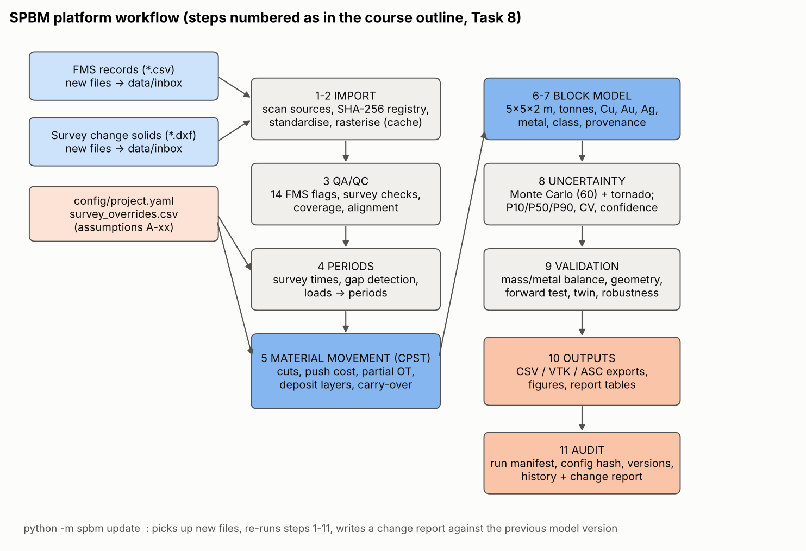
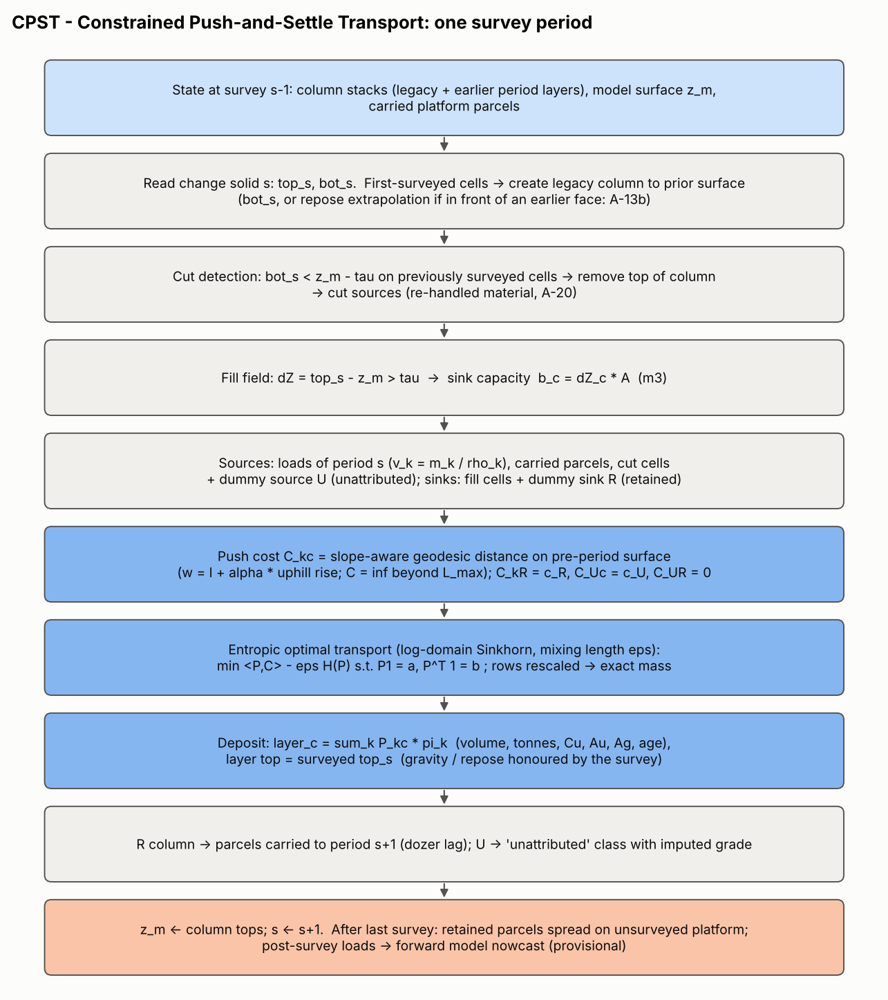

# 1. Purpose and design philosophy

The movement of material from a truck dump point to its final place in the pile is never observed. Two kinds of observation constrain it:

* **where material came from**: FMS dump coordinates, tonnage and grade (*sources*);
* **where volume appeared**: the sequential survey change solids (*sinks*).

Physics-only rules (push to the crest, roll down at the angle of repose) can predict the shape of a deposit, but they predict *where* fill appears only moderately well. Our forward model places 40% of predicted volume inside the observed fill footprint on unseen periods (Section 9.3). A reconstruction used for inventory must therefore be **constrained by the surveys**. The design principle is:

> *Let the surveys decide **where** volume went, let the FMS decide **what** went there, and use a physically based transport cost (dozer push work over the real terrain) to decide **which** source filled **which** part of the observed fill, conserving mass and metal exactly.*

This is a classical earth-moving problem. Optimal transport was formulated by Monge (1781) to move *déblais* (cuts) to *remblais* (fills) with minimum work. We use its modern entropy-regularised form (Cuturi, 2013; Peyré and Cuturi, 2019), where the regularisation strength is a physically interpretable **mixing length**. We name the method **CPST: Constrained Push-and-Settle Transport**. A separate **forward physics model** (dozer push to crest + avalanche cellular automaton at the angle of repose) is used for prediction (temporal validation), for loads not yet surveyed (nowcast), and to generate known-truth data (synthetic twin validation).



# 2. Data model

## 2.1 Grid and survey change solids

A regular grid of cell size $\Delta$ = 1 m (A-24) covers all data plus a 6 m margin. Its origin is snapped to a 10 m lattice so that grids of different resolution share block boundaries. Each survey file *s* is a closed triangulated solid (QA-S01). It is rasterised at cell centres $c$ by barycentric interpolation. The highest face through a centre gives $\text{top}_s(c)$ and the lowest gives $\text{bot}_s(c)$. Cells crossed by no face are outside the solid. The implementation is vectorised (`spbm/grid.py::rasterize_triangles`) and independent of face winding.

## 2.2 State: stratigraphic columns

The stockpile state is a **column of layers** for every cell. Each layer $\ell$ has a bottom and top elevation and a vector of **extensive** properties:

$$\boldsymbol{\pi}_\ell = (V,\; T_F, Cu_F, Au_F, Ag_F,\; T_U, Cu_U, Au_U, Ag_U,\; T_L, Cu_L, Au_L, Ag_L,\; \Sigma m\,g_{Cu}^2,\; \Sigma m\,g_{Au}^2,\; \Sigma m\,t,\; \Sigma m^2,\; T_R)$$

Here $V$ is volume (m³) and $T$ is tonnes. $Cu$ is tonnes of copper ($m\,g_{Cu}/100$). $Au$ and $Ag$ are kilograms ($m\,g/1000$). The subscripts F, U, L and R mean FMS-tracked, unattributed, legacy and provisional. Every operation of the algorithm (deposit, split, cut, mix) is a **non-negative linear combination** of these vectors. Mass and metal are therefore conserved by construction, and grades are always derived as ratios (e.g. $g_{Cu} = 100\,\sum Cu / \sum T$), never averaged directly.

## 2.3 Periods and the survey cut-off (A-05)

A survey labelled day $D$ (its corrected nominal date) closes its interval at

$$t_s = D\;00{:}00 + h_c,\qquad h_c = 31\text{ h}\;(D{+}1\;07{:}00)$$

Period *s* is $(t_{s-1}, t_s]$; the first period starts $24$ h before $t_0$. A load with time $t_k$ belongs to period *s* if $t_{s-1} < t_k \le t_s$. Loads after the last cut-off are *provisional*. A period is a **gap period** if $t_s - t_{s-1} > 36$ h, or if more than 10% of previously surveyed cells inside solid *s* have $\text{bot}_s$ above the model surface by more than τ (a missing intermediate survey).

**How $h_c$ was chosen.** The acquisition time is not supplied, so $h_c$ is scanned from 0 to 36 h in 0.5 h steps (`growth.temporal_alignment`). For each $h$ the loads are re-assigned to intervals, and two scale-free scores compare the interval FMS volume $\sum T/\text{Dens}$ with the surveyed solid volume: the Pearson correlation $r$, and the robust coefficient of variation of their ratio ($1.4826\,\text{MAD}/\text{median}$). Both scores are computed on intervals between consecutive-day surveys, which is a set fixed independently of $h$. The scan has a plateau from 30 h to 31.5 h ($r$ = 0.992, robust CV 0.08), against $r$ = 0.961 and robust CV 0.24 at 24 h (midnight). Independent evidence comes from the dump times. The FMS has almost no dumps between 06:00 and 07:30 (2 of 275), and none from 18:30 to 20:00 or from 00:00 to 01:30. These are shift-change and meal lulls. Any cut-off between 06:00 and 07:30 therefore assigns the same loads, and 07:00 (31 h) is the production-day convention at the end of that lull. The cut-off is sampled over 29-32 h in the Monte Carlo. A survey-specific cut-off can be set by a `survey_cutoff_hours` manual intervention.

An earlier version of this platform scanned only clock times 21:00-23:59 on day $D$. Its optimum (23:59) was the **end point of the search range**, not a maximum. That misassigned the early-morning dumps of each production day to the wrong interval, and it made 03-17 look like an FMS outage when it was a non-dumping day.

## 2.4 Volume conversion: volume factor and payload factor (A-06)

For every interval, the measured net fill is $N_k$ = fill − cut, from the change solids. The FMS volume at the recorded density is $V_k = \sum_{i\in k} T_i/\text{Dens}_i$. On intervals whose FMS record is complete, $N_k/V_k$ is a stable 1.39-1.58. On intervals with FMS outages it is 2.2-2.4. The **volume factor** is the pooled ratio over the internally consistent intervals:

$$f_v = \frac{\sum_{k\in\mathcal K} N_k}{\sum_{k\in\mathcal K} V_k},\qquad \mathcal K = \{k : |r_k - \tilde r| \le 3 \cdot 1.4826\,\text{MAD}(r)\}$$

The result is $f_v$ = 1.472, with $\mathcal K$ = intervals 1-6 and 8 (`spbm/volume.py`). The intervals are resampled (bootstrap) to give its distribution, P10-P90 1.40-1.52. Two hold-out tests check that $f_v$ predicts volume rather than just fitting it:

* calibrate on the first half of the record and predict the second (mean absolute error 3.5% on the held-out consistent intervals, against 8.7% for a constant density and 32% for $f_v$ = 1);
* leave one interval out (7.9%).

$f_v$ fixes the **in-pile volume** of a load. It does not say how many tonnes that volume holds. Write the true tonnes as $T\,f_{pay}$, where $f_{pay}$ is the payload factor (systematic under-recording). Then

$$v_i = \frac{T_i\,f_v}{\text{Dens}_i},\qquad m_i = T_i\,f_{pay},\qquad \rho_i = \text{Dens}_i\,\frac{f_{pay}}{f_v}$$

The in-pile volume $v_i$ is the same for **any** split between bulking ($\rho < \text{Dens}$) and under-recording ($f_{pay} > 1$). This split is not identifiable from the supplied data. The base case is $f_{pay}$ = 1: recorded tonnes are taken as measured, and the excess volume is bulking, giving an in-pile density of 1.40 t/m³. The Monte Carlo samples $f_{pay}$ from a triangular distribution on 1.00-1.19 with its mode at 1.00 (recorded payloads most likely). The upper bound takes the largest recorded load, 304 t, to 362 t, the rated payload of the largest haul trucks. Two further interpretations are reported as scenarios outside the ranges (D6, Section 10):

* X1: all of the excess is payload under-recording. This is excluded, because the largest load would be 448 t.
* X2: the excess is loads missing from the FMS. This is not excluded by these data.

# 3. The CPST algorithm (one period)



## 3.1 Prior surface and legacy material (first-surveyed cells)

For a cell surveyed for the first time, the prior elevation $z^{0}_c$ is the solid bottom $\text{bot}_s(c)$. The platform has an optional exception (A-13b, **off in the base case** and tested in the sensitivity analysis). If the cell lies **in front of** a previously surveyed face, its prior elevation cannot exceed the repose-angle continuation of that face:

$$z^{\text{inf}}_c = \max\!\big(B_c,\; z_n - d_{cn}\tan\phi\big),\qquad z^{0}_c = \begin{cases} z^{\text{inf}}_c & \text{if } z^{\text{inf}}_c < \text{bot}_s(c) - \tau\\ \text{bot}_s(c) & \text{otherwise}\end{cases}$$

Here $n$ is the nearest surveyed cell, $d_{cn}$ the distance, $\phi = 37°$ and $B$ the fitted floor plane. "In front" is decided by the down-slope direction of the surveyed surface at $n$. The cell is in front if the vector $n\to c$ points down-slope (|cos| > 0.3); otherwise the cell is behind (on the platform). The difference $\text{bot}_s - z^{0}$ would be fill placed during the record that no solid captured (toe-clipped solids, missing surveys). With A-13b on, it joins this period's fill (about 7,200 m³ over the record). The calibrated volume factor shows why A-13b is off in the base case. Recorded loads already explain the *measured* fill of complete intervals to about 3%, so this extra volume would have to be unrecorded material on days whose FMS record is complete. A **legacy layer** (the pre-record core) from $\min(B_c, z^0_c)$ to $z^0_c$ is created with assumed properties (A-22).

## 3.2 Cuts (elevation decrease)

For previously surveyed cells, $\delta_c = \text{bot}_s(c) - z_m(c) < -\tau$ indicates material removed since the last observation (A-20). The top $|\delta_c|$ of the column is removed. Its extensive properties $\boldsymbol\Pi_j$ (split proportionally within the cut layer) become a **cut source** $j$ located at cell $c$.

## 3.3 Fill field (sinks)

$$\Delta Z_c = \text{top}_s(c) - z_m(c),\qquad b_c = \Delta Z_c\,\Delta^2 \;\;\text{for}\;\; \Delta Z_c > \tau$$

with the detection limit $\tau = k\sqrt2\,\sigma_z$ = 0.14 m (A-08, A-09).

## 3.4 Sources

* **Loads** $k$ of the period: $v_k = T_k f_v/\text{Dens}_k$ m³ and $m_k = T_k f_{pay}$ t (Section 2.4), located at the dump cell. Properties per m³: $\boldsymbol\pi_k = \boldsymbol\Pi(m_k, g_k)/v_k$ (question A: *initial placement* is a point parcel at the reported X/Y; GPS uncertainty is handled by Monte Carlo, Section 7). Records whose position is a default or stuck FMS position (QA rule LOC_DEFAULT: 14 records, 2,356 t sharing one X/Y/Z) or more than 100 m from every solid (LOC_OUTSIDE_DOMAIN) have an **unknown location** (A-32). They are not given an imputed position. Their push-cost row is instead uniform (the median of the located sources' costs), so they fill whatever part of the period's fill the located loads do not claim.
* **Carried parcels** from the previous period (A-23), at their original dump cell.
* **Cut sources** $j$ (Section 3.2).
* **Dummy source U** (unattributed) with volume $V_F = \sum_c b_c$.

Sinks are the fill cells $c$, plus a **dummy sink R** (retained on the platform) with capacity $V_S = \sum_k v_k + \sum_j V_j$. The problem is balanced: $\sum a = V_S + V_F = \sum b$.

## 3.5 Push cost (questions B, C)

On the pre-period surface $z$ (surveyed or inferred), a directed 8-neighbour graph is built. The edge weight from cell $i$ to neighbour $j$ is

$$w_{ij} = \ell_{ij} + \alpha \max(0,\, z_j - z_i)$$

where $\ell_{ij}$ = 1 or √2 m and α = 4 is the uphill penalty (A-16). The push cost is the geodesic (Dijkstra) distance $C_{kc} = \min_{\text{paths}} \sum w$, with $C_{kc} = \infty$ if $C_{kc} > L_{\max}$ = 90 m (A-17). Dummy costs: $C_{kR} = c_R$ = 90 m, $C_{Uc} = c_U$ = 90 m, $C_{UR} = 0$. Because $c_R + c_U > L_{\max}$, a load is always sent to reachable fill before being retained. U fills only the volume that available sources cannot (*partial optimal transport*).

*Direction* (B) is therefore the least-work route over the actual terrain: down-slope pushes are cheap, pushing over a crest and down the face is cheap, uphill is expensive. The survey decides which face sector actually received fill. *Distance* (C) is set by the capacity constraint: material stops where observed accommodation space exists, and the least-cost assignment is used. Movement beyond $L_{\max}$ is not allowed. Material that finds no reachable fill stays on the platform (R) and is carried to the next period (dozer lag).

## 3.6 Allocation: entropic optimal transport (questions E, F, G, H)

$$\mathbf P^\star = \arg\min_{\mathbf P \ge 0} \;\sum_{k,c} P_{kc} C_{kc} \;-\; \varepsilon H(\mathbf P)\quad \text{s.t.}\;\; \mathbf P\mathbf 1 = \mathbf a,\;\; \mathbf P^\top\mathbf 1 = \mathbf b,\qquad H(\mathbf P) = -\sum P_{kc}(\log P_{kc} - 1)$$

The solution is $P_{kc} = \exp\big((f_k + g_c - C_{kc})/\varepsilon\big)$. It is computed by **log-domain Sinkhorn** iterations (numerically stable with infinite costs):

$$f_k \leftarrow \varepsilon\log a_k - \varepsilon\,\text{LSE}_c\!\left(\tfrac{g_c - C_{kc}}{\varepsilon}\right),\qquad g_c \leftarrow \varepsilon\log b_c - \varepsilon\,\text{LSE}_k\!\left(\tfrac{f_k - C_{kc}}{\varepsilon}\right)$$

Iteration stops when $\sum_k |\sum_c P_{kc} - a_k| / \sum a < 10^{-6}$ (max. 5000 iterations). A final row rescaling $P_{kc} \leftarrow P_{kc}\,a_k/\sum_c P_{kc}$ makes **each source's volume exactly conserved**. The remaining column residual (< 10⁻⁶ relative in all intervals) is reported as the numerical reconciliation error.

**ε is the mixing length** (A-18). As ε → 0 the plan becomes the work-minimising deterministic assignment (no mixing beyond what is geometrically forced). As ε → ∞ every source is spread uniformly over the period's fill, giving the "period-average" model. ε = 6 m represents GPS error, blade spill and rolling on the face. Its effect is quantified by the twin experiment, the tornado and the Monte Carlo.

## 3.7 Deposit (questions D, E, F, I)

Each fill cell receives one new layer from $z_m(c)$ up to $z_m(c) + \sum_k P_{kc}/\Delta^2$, which equals the surveyed $\text{top}_s(c)$ to solver tolerance:

$$\boldsymbol\pi_{\text{layer},c} = \sum_{k} P_{kc}\,\boldsymbol\pi_k \;+\; P_{Uc}\,\boldsymbol\pi_U,\qquad \Sigma m^2_{c} = \sum_k \big(P_{kc}\,m_k/v_k\big)^2$$

*Downslope behaviour* (D) is honoured because the layer top is the surveyed surface: faces are at the measured angle of repose (median 36.7°), and the material that formed them, including what rolled to the toe, is assigned by the transport plan. Within one period the layer is vertically homogeneous (A-19). *Mixing* (E) is the volume-weighted combination of sources in the same cell. Grades follow from metal over tonnes, so mixing of loads with different densities is handled correctly. *Surface reconciliation* (F) holds because the column marginals equal the observed fill: the model surface equals the survey (Section 9.2). The unattributed U volume carries the imputed properties $\boldsymbol\pi_U$ (A-21).

## 3.8 Sequential updating (I) and closing the record

After deposit, $z_m$ = column tops, the volume in column R becomes carried parcels, and the next period starts from this state. After the last survey:

1. Never-surveyed domain cells receive legacy columns up to the inferred pre-record surface (A-13).
2. Parcels still retained are spread (Gaussian kernel, σ = 6 m) over **unsurveyed** platform cells around their dump point.
3. Loads after the last survey are placed by the forward model (Section 4) and flagged *Provisional*. When the next survey is imported they are automatically reconciled like any other load.

## 3.9 Mass and metal conservation (G, H)

* Every source row of $\mathbf P$ sums exactly to the source volume, so no FMS tonne is created or lost.
* Cuts move extensive properties from columns to sources and back into columns.
* The dummy U adds volume only to the *unattributed* class; legacy volume is only in the *legacy* class. FMS totals are therefore checked separately from them.
* Verification: FMS tonnes, Cu, Au and Ag in the final block model differ from the FMS input by 3×10⁻¹² (relative), i.e. floating-point round-off. This is enforced by the automated test `tests/test_real_data.py::test_mass_and_metal_conserved_exactly`.

## 3.10 Numerical stability (J)

| Setting | Value | Effect tested |
|---|---|---|
| Grid cell | 1 m (0.5 and 2.5 m tested) | Robustness table, Section 9.6 |
| Detection limit τ | 0.14 m (k = 1-4 tested) | Volume not moved: 96 m³ (0.2%) |
| Sinkhorn tolerance | 10⁻⁶ (10⁻⁴, 10⁻⁸ tested) | Column residual < 10⁻⁶ |
| Log-domain Sinkhorn | always | No underflow with costs ≫ ε |
| Time step | one survey interval (cut-off D+1 07:00, data-driven) | Gap periods flagged |
| Block size | 5 × 5 × 2 m (2 × 2 × 1 and 10 × 10 × 4 tested) | Tornado |

Typical convergence takes 30-660 Sinkhorn iterations per interval. A full reconstruction takes about 15 s.

## 3.11 Pseudocode

```text
INPUT  surveys s = 0..S-1 (top_s, bot_s, t_s), loads k (x, y, t, m, g, rho), config
STATE  columns[c] = list of (z_bot, z_top, props);  z_m[c];  observed[c];  carried = []
B <- fit_floor_plane(toe cells)            ; domain <- hull(survey cells, dumps)
for s in 0..S-1:
    F <- cells with finite top_s
    for c in F not observed:               # first-surveyed cells
        z0 <- bot_s[c]
        if s>0 and front_of_earlier_face(c): z0 <- min(z0, repose_extrapolation(c))
        columns[c] <- [legacy layer B..z0]
    for c in F observed and bot_s[c] < z_m[c]-tau:
        cut_sources += remove_top(columns[c], z_m[c]-bot_s[c])
    fill <- {c in F : top_s[c]-z_m[c] > tau},  b_c <- (top_s-z_m)*A
    sources <- carried + loads(period s) + cut_sources
    a <- [v_k ..., V_fill],  b <- [b_c ..., V_sources]
    C <- geodesic_cost(surface, alpha, L_max) ; add dummy costs c_R, c_U, 0
    P <- sinkhorn_log(a, b, C, eps) ; P <- rescale_rows(P, a)
    for c in fill: append layer sum_k P[k,c]*pi_k + P[U,c]*pi_U to columns[c]
    carried <- {k : P[k,R] > 0}            # dozer lag
    observed[F] <- True
add legacy columns on never-surveyed domain cells (inferred surface)
spread carried parcels on unsurveyed cells; nowcast post-survey loads (forward model)
blocks <- integrate layers into 5x5x2 m blocks (exact partial-layer fractions)
```

# 4. Forward (predictive) physics model

Used where no survey constrains the result (temporal validation, nowcasting, synthetic truth). Code: `spbm/forward.py`.

1. **Crest detection.** On the surface smoothed with a 1.5 m Gaussian, a face cell has slope > 20° and at least 5 m of local relief within 11 m. Crest cells are gentle cells adjacent to a face and near the local maximum. Only crests within the surveyed area are used.
2. **Dozer push.** Each load is pushed to the nearest crest cell and released down-slope onto the face (release offset 0-4 m, calibrated), as a disc of radius 2-5 m (calibrated).
3. **Gravity / avalanche cellular automaton.** Only the newly placed (*mobile*) material may move. For each cell $i$ and neighbour $j$, the excess is $e_{ij} = \max(0, z_i - z_j - \ell_{ij}\tan\phi)$. The cell releases $o_i = \min(\tfrac12\max_j e_{ij},\, \text{mobile}_i)$, distributed to neighbours in proportion to $e_{ij}$. This repeats until $\max o_i < 0.01$ m. Volume is conserved exactly (unit test). Slopes relax to ≤ φ.

# 5. Block model construction (Task 5)

* **Blocks**: 5 m × 5 m × 2 m, origin (511,290; 7,122,288; 4,474). Horizontal size: GPS error (σ ≈ 3 m) plus the mixing length (6 m) mean no information exists below about 5 m. Vertical size: 2 m gives 6-8 slices over the 13-15 m face, matching the vertical resolution of daily layers (median solid thickness 0.9-3.0 m). It also suits loader reclaim slices. Larger and smaller blocks were tested (tornado).
* **Discretisation / partial blocks**: layers are integrated exactly into blocks (the fraction of each layer's thickness inside each 2 m slice). No sub-blocking is needed: each block carries its **fill fraction** and true material volume; partial blocks are exported, not rounded.
* **Density**: in-pile density $\text{Dens}\cdot f_{pay}/f_v$ per load for FMS material (1.40 t/m³ on average in the base case). Imputed density for unattributed fill (same and adjacent periods). Mean in-pile density of the FMS loads for the pre-record core. Block density = tonnes / volume (derived, never averaged).
* **Grade compositing / mixing**: tonnage-weighted via extensive metal. The within-block heterogeneity $s_{Cu} = \sqrt{\Sigma m g^2/\Sigma m - \bar g^2}$ is reported.
* **Provenance**: a sparse load × block tonnage matrix built from the stored transport plans. It gives the effective number of loads $n_\text{eff} = (\sum t)^2/\sum t^2$ and the top three contributing cycle IDs per block (traceability for reconciliation with mill results).
* **Uninformed regions**: legacy (pre-record) material and unattributed fill are kept in **separate tonnage fields**. A block's `info_class` is its dominant class. Geometry is flagged by `top_surveyed_frac`.

Fields exported per block: indices and centroid, dimensions, volume, fill fraction, tonnes, density, Cu %, Au g/t, Ag g/t, contained Cu (t), Au (kg), Ag (kg), tonnes by class, FMS-only grades, within-block SD, n_eff, top loads, mean placement date, surveyed-top fraction, Monte Carlo P10/P50/P90 and CV, information class and confidence class.

## 5.1 Confidence classification

| Class | Rule |
|---|---|
| High | ≥ 80% of tonnes FMS-tracked, Cu CV ≤ 10%, ≥ 50% of footprint has a surveyed top |
| Medium | ≥ 50% FMS-tracked and Cu CV ≤ 20% |
| Low | ≥ 20% FMS-tracked |
| Uninformed | < 20% FMS-tracked (legacy or unattributed dominated) |

These are internal planning classes, **not** JORC/NI 43-101 resource categories. Public reporting would require a Competent/Qualified Person.

# 6. Information types

| Quantity | Type |
|---|---|
| Dump X/Y, timestamp, payload, source grade, density | Measured (with stated errors) |
| Survey top/bottom surfaces in solid footprints | Measured |
| Survey cut-off (31 h), file re-dating, volume factor $f_v$ | Inferred from data (calibrated, hold-out tested) |
| Floor plane, pre-record surface outside solids, front-of-face prior | Inferred |
| Legacy grade/density, unattributed grade, payload factor $f_{pay}$ (bulking vs under-recording split), φ in unsurveyed areas | Assumed |
| Location of each load inside the fill, block grades, uncertainty ranges | Model-generated |

# 7. Uncertainty methodology (Task 7)

**Monte Carlo** (60 realisations, seed 413). Each realisation runs the full reconstruction with jointly sampled inputs:

| Source | Sampling |
|---|---|
| Truck GPS error | X, Y + N(0, 3 m) per load |
| Tonnage measurement | × (1 + N(0, 0.08)) per load |
| Payload factor (systematic) | $f_{pay}$ ~ triangular(1.00, 1.00, 1.19): recorded payloads most likely, under-recording up to the truck-rating bound |
| Volume factor | $f_v$ drawn from the bootstrap distribution calibrated at the sampled cut-off |
| Assay / source grade | × (1 + N(0, 0.10)) per grade signature (Cu, Au, Ag independently) |
| Survey error | vertical bias N(0, 0.05 m) per survey |
| Survey cut-off | $h_c$ ∈ {29, 29.5, ..., 32} h (each with its own calibration of $f_v$) |
| Degree of mixing | ε ~ U(2, 15) m |
| Unknown dozer trajectories | α ~ U(1, 10) |
| Movement distance | L_max ~ U(50, 130) m |
| Missing data | unattributed grade drawn by tonnage-weighted bootstrap of the period's loads |

Blocks are accumulated on the base block grid. For each block we report P10/P50/P90 and the coefficient of variation of Cu, Au and tonnes. For the record-period inventory (FMS-tracked + unattributed) and for the whole pile we report P10/P50/P90 totals. **One-at-a-time sensitivity** (tornado) varies ε, α, $L_{\max}$, $f_{pay}$, $f_v$, σz, survey cut-off, grid cell, block size and the A-13b switch individually. The cut-off, grid and σz variants re-calibrate $f_v$.

**Scenarios outside the ranges.** The interpretations of the volume gap that the data cannot exclude (X2: missing loads) or that physics excludes (X1: all under-recording) are run as separate deterministic scenarios (`uncertainty.scenarios`). They are reported next to the ranges with an explicit "not included in those ranges" statement.

# 8. Validation methodology (Task 6)

| Area | Metric |
|---|---|
| Geometry | RMSE, bias, P1/P99, volume difference of model top vs latest surveyed top; fraction within τ; error map |
| Mass balance | FMS tonnes in vs block model (by class); unattributed and retained volumes per period |
| Metal balance | Cu, Au, Ag in vs block model |
| Volume conversion | $f_v$ calibrated on the first half of the record, predicting the second half; leave-one-out (Section 2.4) |
| Temporal | Forward model calibrated on periods 1-5, tested on 6-9 (unseen). Metrics: Wasserstein-1 (earth mover's) distance between predicted and observed fill (m), capture ratio (share of predicted volume inside observed fill), centroid error. Baselines: no dozer push (deposit at the dump point), and uniform spreading over the model domain |
| Inversion skill | Synthetic twin: truth generated with the forward model (push jitter 6 m), observed with GPS noise (3 m), payload noise (5%), 15% missing FMS records and survey noise. Block Cu/Au RMSE and correlation vs truth for CPST variants and baselines |
| Robustness | Grid 0.5/1/2.5 m, Sinkhorn tolerance, detection limit: totals, top-bench grade, mean absolute block change |

# 9. Implementation map

| Function | Module |
|---|---|
| Managed raw store, manual interventions, readers | `spbm/io.py`, `spbm/dataset.py` |
| QA rule catalogue (record, file, dataset) | `spbm/rules.py`, `spbm/qaqc.py` |
| Volume factor calibration and hold-out | `spbm/volume.py` |
| Rasterisation | `spbm/grid.py` |
| Floor, domain, inference | `spbm/surfaces.py` |
| QA/QC | `spbm/qaqc.py` |
| Survey cut-off scan, growth | `spbm/growth.py` |
| CPST engine | `spbm/movement.py` (`reconstruct`, `sinkhorn`, `geodesic_cost`) |
| Forward model | `spbm/forward.py` |
| Block model, exports | `spbm/blockmodel.py`, `spbm/bmviz.py` |
| Validation | `spbm/validation.py` |
| Uncertainty / sensitivity / scenarios | `spbm/uncertainty.py` |
| Audit trail | `spbm/audit.py` |
| Orchestration / CLI | `spbm/pipeline.py`, `spbm/__main__.py` |

# References

* Monge, G. (1781). *Mémoire sur la théorie des déblais et des remblais.* Histoire de l'Académie Royale des Sciences de Paris.
* Cuturi, M. (2013). Sinkhorn distances: lightspeed computation of optimal transport. *Advances in Neural Information Processing Systems* 26.
* Peyré, G. and Cuturi, M. (2019). Computational optimal transport. *Foundations and Trends in Machine Learning* 11(5-6), 355-607.
* Chizat, L., Peyré, G., Schmitzer, B. and Vialard, F.-X. (2018). Scaling algorithms for unbalanced optimal transport problems. *Mathematics of Computation* 87, 2563-2609.
* Bak, P., Tang, C. and Wiesenfeld, K. (1987). Self-organized criticality: an explanation of 1/f noise. *Physical Review Letters* 59, 381-384 (sandpile cellular automata).
* Wheaton, J.M., Brasington, J., Darby, S.E. and Sear, D.A. (2010). Accounting for uncertainty in DEMs from repeat topographic surveys. *Earth Surface Processes and Landforms* 35, 136-156 (level of detection).
* Caterpillar Inc. *Caterpillar Performance Handbook* (current edition). Dozer production and grade-correction factors.
* Dijkstra, E.W. (1959). A note on two problems in connexion with graphs. *Numerische Mathematik* 1, 269-271.
