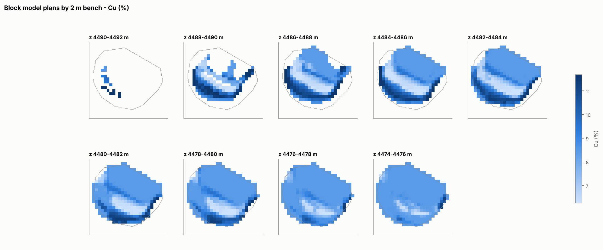
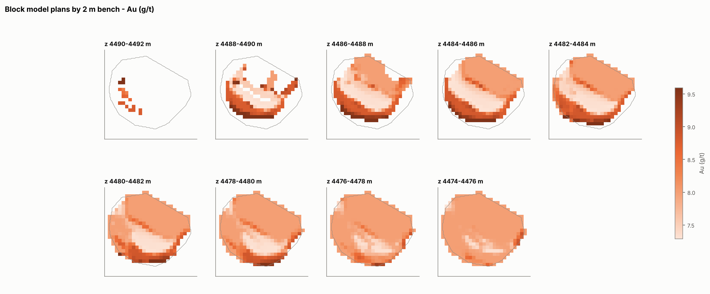
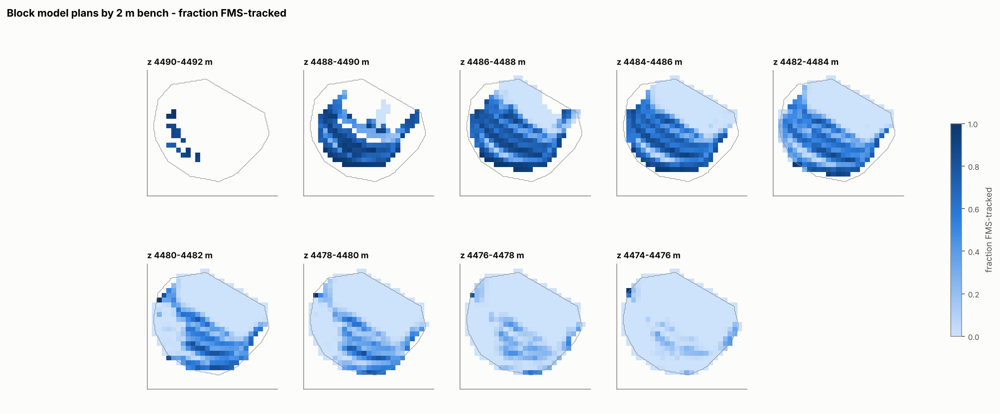
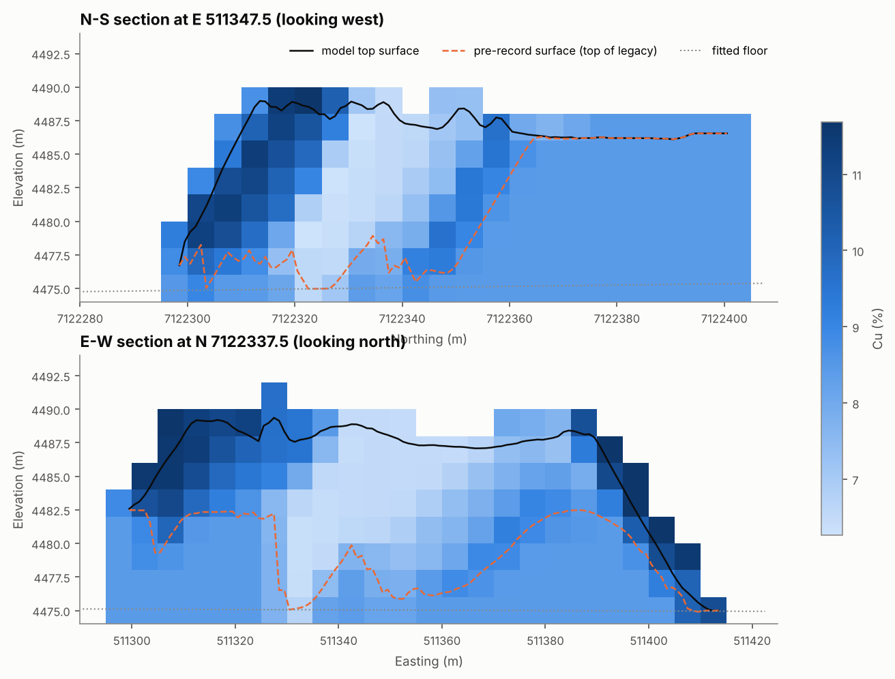
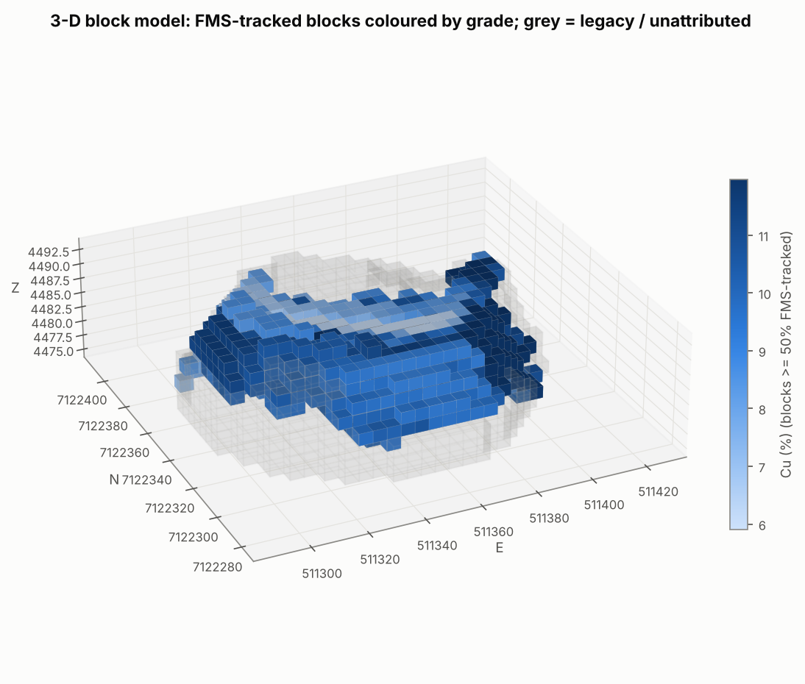
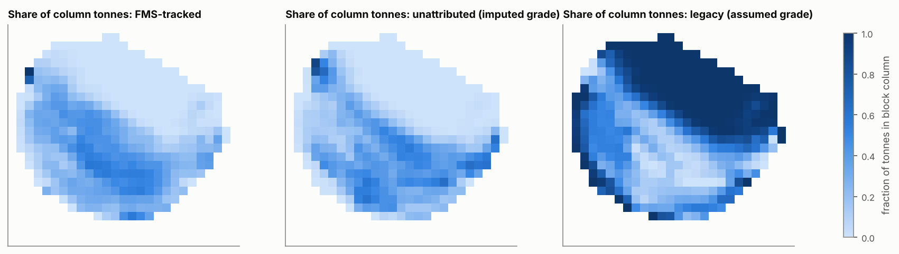
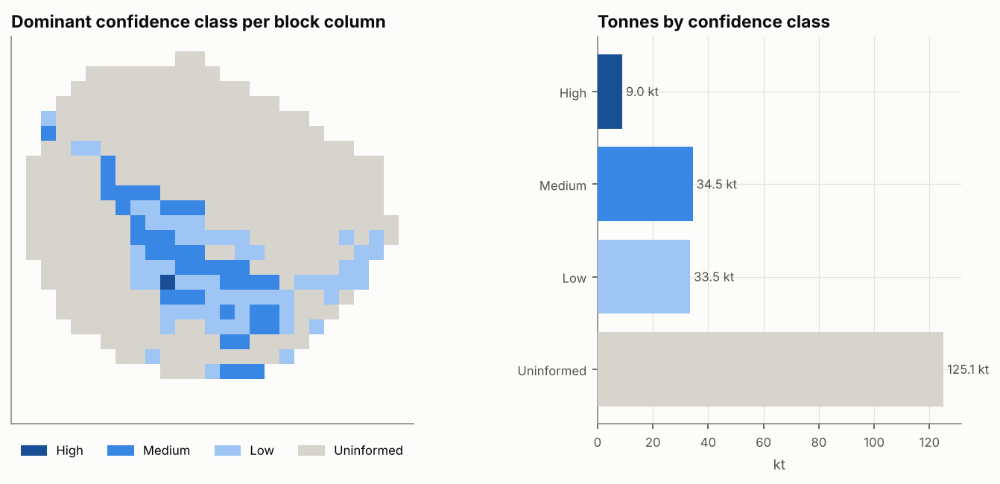
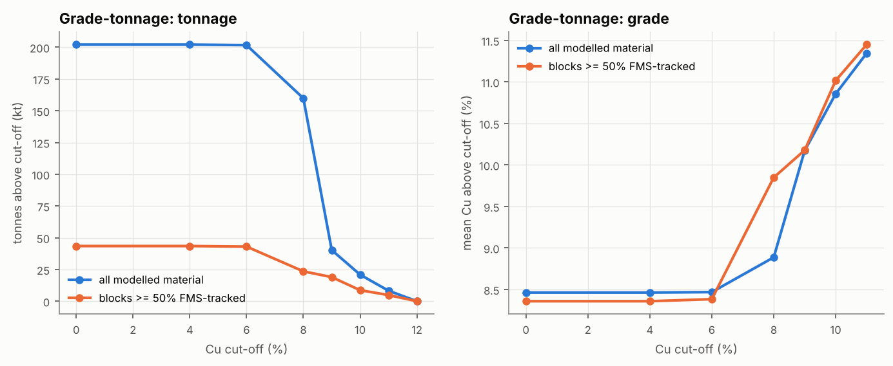
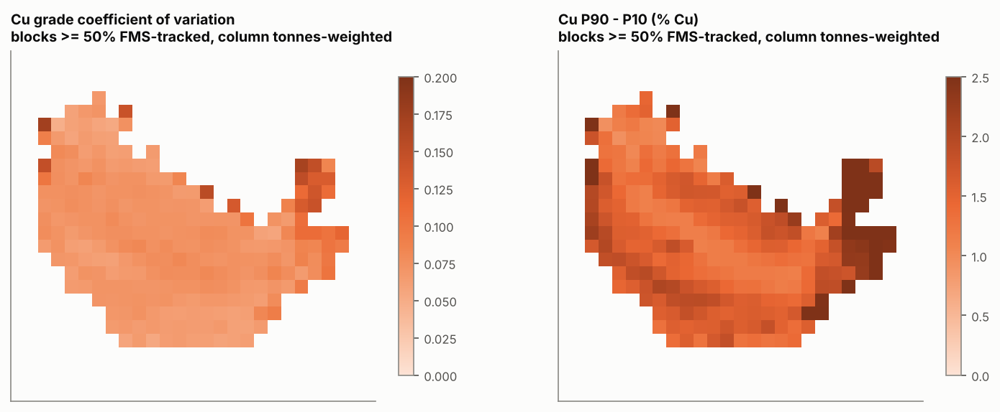

# 1. Model files

| File | Format | Use |
|---|---|---|
| `outputs/blockmodel/stockpile_block_model.csv` | CSV, one row per block containing material (2,695 blocks) | Excel, Vulcan, Datamine, Leapfrog, Deswik (import with centroid + size) |
| `outputs/blockmodel/stockpile_block_model.vtk` | VTK structured points, cell data | ParaView 3-D viewing (*Threshold* `tonnes > 0`) |
| `outputs/blockmodel/block_model_definition.json` | JSON | Origin, block size, dimensions, units, CRS note |
| `outputs/movement/*.asc` | ESRI ASCII grids (1 m) | Floor plane, pre-record surface, final model surface, latest surveyed surface (GIS / CAD) |
| `outputs/movement/load_destinations.csv` | CSV | Where each truck load was placed (destination centroid, push distance, spread) |
| `outputs/blockmodel/summary_*.csv` | CSV | Inventory by information class, confidence class, 4 m bench, material source; grade-tonnage |

**Block definition.** Origin (lower-left-bottom corner) E 511,290, N 7,122,280, Z 4,474.0. Blocks 5 × 5 × 2 m; 27 × 26 × 10 blocks. Partial blocks are exported with `fill_frac` and their true material volume. Coordinates are in the mine grid (see D2, A-01).

**Units.** Tonnes are as reported by the FMS (moisture basis not stated, A-26). Cu is in %, Au and Ag in g/t (as supplied, see QA-F04). Contained Cu is in tonnes, Au and Ag in kg (1 koz = 31.1035 kg).

## 1.1 Block fields

| Field | Meaning | Info type |
|---|---|---|
| `ix, iy, iz, xc, yc, zc, dx, dy, dz` | Block index, centroid, size | - |
| `volume_m3`, `fill_frac` | Material volume in block; fraction of block filled | Measured geometry + inferred where unsurveyed |
| `tonnes`, `density` | Total tonnes; derived bulk density | Measured / assumed by class |
| `cu_pct, au_gpt, ag_gpt` | Best-estimate grade (all classes) | Mixed: see class fractions |
| `cu_t, au_kg, ag_kg` | Contained metal | Mixed |
| `t_fms, t_unattributed, t_legacy, t_provisional` | Tonnes by information class | - |
| `frac_fms, frac_unattributed, frac_legacy` | Class fractions | - |
| `cu_pct_fms, au_gpt_fms` | Grade of the FMS-tracked part only | Measured inputs, model-generated placement |
| `cu_sd_within, au_sd_within` | Grade heterogeneity among the loads mixed into the block | Model-generated |
| `n_eff_loads, n_loads_ge1pct, top_loads` | Effective number of loads; loads ≥ 1% of block; top three cycle IDs with share | Model-generated provenance |
| `mean_place_date` | Tonnage-weighted placement time of FMS material | Measured + model |
| `top_surveyed_frac` | Fraction of block footprint whose top surface was surveyed | Measured |
| `cu_p10/p50/p90, au_p10/p50/p90, tonnes_p10/p90, cu_cv, au_cv, tonnes_cv` | Uncertainty (Monte Carlo, 60 realisations; prior load-scale range for blocks < 50% FMS-tracked, see `grade_range_basis`) | Model-generated |
| `info_class` | Dominant class: FMS-reconciled / Unattributed-imputed / Legacy-assumed / Provisional | - |
| `confidence` | High / Medium / Low / Uninformed (rules in D3, Section 5.1) | - |

# 2. Inventory

## 2.1 By information class (base case)

*Inventory by information class (FMS grades/metal shown for the whole FMS class)*

| class | tonnes | share | Cu % | Au g/t | Cu (t) | Au (koz) | basis of grade |
|---|---|---|---|---|---|---|---|
| FMS-tracked, survey-reconciled | 44,422 | 22.0% | 8.42 | 8.00 | 3,760 | 11.5 | measured inputs; location model-generated |
| FMS-tracked, provisional (after last survey) | 228 | 0.1% |  |  |  |  | measured inputs; location from forward model |
| Unattributed (surveyed volume, no FMS record) | 41,758 | 20.7% | 8.62 | 8.00 | 3,598 | 10.7 | imputed (same/adjacent periods) |
| Legacy (pre-record pile) | 115,699 | 57.2% | 8.42 | 8.00 | 9,744 | 29.8 | assumed (FMS mean) |
| Total modelled | 202,107 | 100.0% | 8.46 | 8.00 | 17,102 | 52.0 |  |

> **Reading this table.** Only the first two rows rest on measured grade data. The grades of the unattributed and legacy rows are imputed or assumed, and their *volumes* depend on assumptions A-13, A-13b and A-14. They must not be summed with the FMS-tracked inventory without that caveat.

## 2.2 By confidence class

*Table 8.1 - Inventory by confidence class*

| confidence | blocks | tonnes | cu_pct | au_gpt | cu_t | au_koz |
|---|---|---|---|---|---|---|
| High | 172 | 8,971 | 8.62 | 8.18 | 773 | 2.4 |
| Medium | 478 | 34,468 | 8.29 | 7.90 | 2,857 | 8.8 |
| Low | 412 | 33,534 | 8.40 | 7.95 | 2,818 | 8.6 |
| Uninformed | 1,633 | 125,134 | 8.51 | 8.03 | 10,654 | 32.3 |

## 2.3 By 4 m reclaim bench

*Table 8.2 - Inventory by 4 m reclaim bench (all classes; see D4 for class split)*

| bench | blocks | tonnes | cu_pct | au_gpt | cu_t | au_koz |
|---|---|---|---|---|---|---|
| 4490-4494 | 18 | 51 | 9.22 | 9.59 | 5 | 0.0 |
| 4486-4490 | 459 | 20,958 | 8.76 | 8.10 | 1,836 | 5.5 |
| 4482-4486 | 671 | 59,209 | 8.46 | 8.00 | 5,011 | 15.2 |
| 4478-4482 | 755 | 68,506 | 8.46 | 7.99 | 5,794 | 17.6 |
| 4474-4478 | 792 | 53,383 | 8.35 | 7.97 | 4,455 | 13.7 |

Source: `outputs/blockmodel/summary_by_bench_4m.csv` (model run 20261007T075413).

# 3. Visualisations

# 4. How to use the model

* **Reclaim sequencing / blending.** Filter `confidence ∈ {High, Medium}` for material whose grade rests on FMS data. Use `cu_p10` and `cu_p90` to test blends against plant constraints. Treat `Legacy-assumed` blocks as unknown-grade material until sampled.
* **Plant-feed / metal forecasting.** Use the bench summaries with their P10-P90 ranges. Report the FMS-tracked inventory separately from imputed and assumed inventories (D6, Section 13).
* **Reconciliation.** `top_loads` and `load_destinations.csv` let mill or stacker grade measurements be compared with the loads predicted to be in a reclaimed block. This is how ε and the push parameters should be calibrated in operation.
* **Updating.** After each new survey run `python -m spbm update`. Provisional blocks will be re-reconciled.
