# Executive Summary

**Request.** The Mine Manager asked for a defensible platform that reconstructs how truck-dumped material moved through the growing Pit I high-grade (HG) stockpile, estimates where it now resides, and produces an updatable block model of tonnage, Cu, Au, contained metal and uncertainty.

**Data.** We received 275 FMS dump records (44,650 t, 2026-03-15 to 03-31) and ten Vulcan survey files. Each survey file is a **closed change solid**: its top is the new surface and its bottom the previous one, over the area that changed. The surveys therefore give measured fill per interval, 35,096 m³ in total. The data also have important gaps:

* payloads are bucket-pass estimates (every value is a multiple of 38 t);
* grades are 21 source-block signatures, not load assays;
* 14 records carry a default (stuck) FMS position;
* two survey files carry the wrong year, and every DXF header declares inches although the data are metres;
* the survey acquisition time is not recorded;
* the FMS is missing records for 03-23 to 03-27 and after 08:17 on 03-29, while the surveys show material being placed.

**Method.** We developed **CPST (Constrained Push-and-Settle Transport)**. In each survey interval, the observed fill defines where material went. The FMS loads, material carried over on the platform, and dozer cuts are the sources. A slope-aware dozer push cost and entropy-regularised optimal transport (mixing length ε = 6 m) decide which source filled which part of the fill. Fill without an FMS source becomes **unattributed** material with an imputed grade. All operations act on tonnes and metal, so **mass and metal are conserved exactly**. Two inputs are calibrated on the data and tested on data held out from the calibration:

* **Survey cut-off.** A survey labelled day D closes its interval at **D+1 07:00**. This was found by scanning 0-36 h, and it coincides with the shift-change lull in dumping.
* **Volume factor.** Measured fill is **f_v = 1.472** times the recorded tonnes ÷ FMS density on every day with a complete FMS record. Calibrated on the first half of the record, it predicts the second half to 3.5%.

> **Grade units are unconfirmed.** The FMS grades average 8.4% Cu and 8.0 g/t Au, roughly an order of magnitude above typical Cu-Au mill feed (QA rule GRADE_UNITS_UNCONFIRMED). All grades and contained-metal figures are **as supplied** and must be confirmed with Geology before any economic use. Tonnages, the spatial distribution and relative grade patterns are not affected.

**Headline result: material placed during the record (15-31 March), tied to surveyed fill.**

| Record-period inventory | Tonnes | Cu % | Au g/t | Cu (t) | Au (koz) | Basis |
|---|---|---|---|---|---|---|
| FMS-tracked (survey-reconciled + 228 t provisional) | 44,650 | 8.42 | 8.00 | 3,760 | 11.5 | Measured tonnes and grades; location model-generated |
| Unattributed (surveyed fill with no FMS record) | 3,901 | 10.22 | 8.82 | 399 | 1.1 | Measured volume; **imputed** grade and density |
| **Record-period total** | **48,551** | 8.57 | 8.06 | 4,159 | 12.6 | |

* Monte Carlo (60 realisations) P10 / P50 / P90: record-period tonnes **48.1 / 52.5 / 56.0 kt**; contained Cu 4.08 / 4.43 / 4.95 kt (as-supplied units). The FMS-tracked Cu grade ranges over 7.98 - 8.79 % (P10-P90).
* **What these ranges include and exclude.** The ranges cover:
  * GPS, payload and assay errors;
  * survey cut-off 29-32 h;
  * the volume factor's calibration uncertainty;
  * the movement parameters;
  * the volume excess read as **bulking, plus up to 19% payload under-recording** (f_pay 1.00-1.19, most likely 1.00).

  They **do not** cover the interpretation that the excess volume is **whole loads missing from the FMS** (scenario X2). The data cannot exclude it. Under X2, record-period tonnes would be **71,338 t (+47%)**. *Not included in those ranges.* Confirming whether the FMS density is a bank or a loose density, and running a pile density test, would settle this (R-02).

**Second: the pre-record core.** Below the earliest surveyed surfaces lies material placed before the record. Its geometry is inferred (floor plane, platform behind the crest) and its grade is assumed equal to the FMS mean. In the base case it holds 89,795 t. With it, the whole modelled pile is 138,346 t (Monte Carlo P10/P50/P90 134 / 148 / 159 kt). **64.9% of the whole-pile tonnes are this core, with an assumed grade**, so the whole-pile number must not be quoted without that qualification.

**Validation.**

* FMS tonnes, Cu, Au and Ag balance to floating-point precision.
* The reconstructed surface matches the latest surveys: RMSE 0.03 m, with 100.0% of cells within the 0.14 m detection limit.
* The volume factor predicts held-out intervals to 3.5%. Reading the FMS density as the in-pile density misses them by 32%.
* On held-out intervals, the forward physics model's earth-mover error is 14.1 m. This compares with 14.3 m without dozer push and 30.6 m for uniform spreading.
* In a synthetic twin with known truth, CPST recovers block Cu with RMSE 0.68% (r = 0.93). A period-average model gives 1.19% and a single mean grade 1.87%.
* In a stress test whose truth uses a placement rule CPST does *not* assume (random crest), CPST still gives 0.68% against 1.06%.
* An independent second implementation of the project (B) reached the same volume factor (1.476), the same consistent intervals and a 47.6 kt record-period inventory (Section 9.8).

**Key conclusions.**

1. The material dumped during the record can be inventoried with stated ranges: 48,551 t, of which 92% is FMS-tracked with measured grades. It forms the outer skin of the pile on the advancing south face and upper benches, and it can support near-term reclaim planning.
2. The largest single uncertainty in tonnes is no longer the algorithm or the survey timing. It is what the 47% volume excess means: bulking, or tonnes that the FMS did not record.
3. The pre-record core dominates the whole-pile tonnage but carries no grade information in the supplied data.

**Recommendations.**

1. Confirm the FMS density basis and test the pile density.
2. Audit the FMS for 03-23 to 03-27 and after 03-29 08:17.
3. Obtain a full-pile survey and any pre-stockpile ground survey.
4. Sample the pre-record core.
5. Record survey acquisition times.
6. Adopt the platform with the governance controls in Section 13. Run `python -m spbm update` after every survey.

# Introduction and Project Objectives

Pit I will be exhausted by the end of 2026. Its long-term HG stockpile then becomes a principal plant feed source. Reclaim sequencing, blending, metal forecasting and economic evaluation all require knowing *what material is where* in the pile. Unlike an in-situ deposit, a stockpile cannot be reconstructed from dump coordinates alone: dozers push loads to and over the crest, and gravity carries material down the face.

The ten objectives of the brief map onto this report as follows. QA/QC (Section 4); growth reconstruction (Section 5); movement algorithm with mass and metal balance (Section 6); 3-D distribution and block model (Section 8); validation (Section 9); sensitivity (Section 10); platform (Section 11); professional practice (Section 13). Assumptions are maintained in the register (Section 7 and D2).

This is version 2.0 of the platform and report. Version 1 was reviewed against an independent implementation of the same brief (B). The review found three things in version 1 that we have corrected:

* its survey-time search ended at its own optimum;
* it never tested the bulking explanation of the volume gap;
* it led with a whole-pile number that was mostly inferred material.

It also identified governance and testing practices worth adopting. What changed, and why, is recorded in the decision log (D1, DEC-11 to DEC-16) and in Appendix A.

# Description of Available Data

| Dataset | Content | Coverage |
|---|---|---|
| FMS (`Dump Data.csv`) | 275 records: cycle ID, payload, Cu %, Au g/t, Ag g/t, density, dump X/Y/Z, timestamp | 2026-03-15 17:43 to 03-31 20:52; 44,650 t |
| Surveys (10 DXF) | Vulcan 3DFACE closed change solids, layer `*_HGHS*` | Nominal dates 03-15, 16, 18, 19, 20, 21, 22, 27, 28, 29 (after re-dating) |
| Not supplied | Full-pile surface, original ground, truck ID, source bench, moisture, density tests, density basis, dozer records, survey acquisition times | - |

Coordinates are a projected mine grid in metres (E ≈ 511,300, N ≈ 7,122,300, Z ≈ 4,480 m). Every DXF header declares `$INSUNITS = 1` (inches) and `$MEASUREMENT = 0` (imperial). This is a template default: in inches the pile would be 2.5 m wide at 114 m elevation. The header is ignored, and the data are read as metres in the same grid as the FMS (A-01). All DXF headers also share one last-saved date (2025-11-14), and the layer names carry the year 2025, so header dates are not used for timing.

# Data Analysis and QA/QC

The full QA/QC is in D2 Section 2 and `outputs/qaqc/`. Every check is a named rule with a level (record, survey file, dataset), a severity and a treatment. 40 rules are checked and 25 are triggered. No record was deleted or edited, and no FMS record met an error rule. Table 4.1 lists the rules that were triggered.

*Table 4.1 - QA rules triggered by the supplied data (full catalogue in D2)*

| rule_id | level | severity | count | tonnes | items |
|---|---|---|---|---|---|
| PAYLOAD_PARTIAL | record | info | 3 | 152 | cycle 666887, 667076, 671660 |
| PAYLOAD_HIGH | record | info | 3 | 874 | cycle 665064, 666376, 668024 |
| GRADE_OUTLIER | record | info | 1 | 114 |  |
| LOC_DEFAULT | record | warning | 14 | 2,356 | cycle 664887, 664959, 665073, 666320, 666394, 666376, 666430, 666471, 666564, 666692, 6... |
| LOC_OUTSIDE_SURVEYS | record | info | 56 | 9,120 |  |
| LOC_Z_INCONSISTENT | record | info | 2 | 380 | cycle 667102, 671466 |
| TIME_AFTER_LAST_SURVEY | record | warning | 1 | 228 | cycle 673291 |
| TIME_DUPLICATE | record | info | 2 | 304 | cycle 666880, 666882 |
| ID_OUT_OF_ORDER | record | info | 33 | 5,358 |  |
| IN_SURVEY_GAP_INTERVAL | record | info | 63 | 9,918 |  |
| DXF_UNITS_HEADER | survey | warning | 10 |  | all files |
| DXF_SAVED_BEFORE_SURVEY | survey | info | 10 |  | all files (TDUPDATE 2025-11-14) |
| SURVEY_NAME_YEAR | survey | error | 2 |  | Topo_250328.dxf, Topo_250329.dxf |
| LAYER_DATE_MISMATCH | survey | info | 8 |  | Topo_260315.dxf, Topo_260316.dxf, Topo_260318.dxf, Topo_260319.dxf, Topo_260320.dxf, To... |
| ZERO_PLAN_AREA_FACES | survey | info | 10 |  | all files (214-639 per file) |
| DEGENERATE_FACES | survey | info | 8 |  | Topo_260315.dxf, Topo_260318.dxf, Topo_260319.dxf, Topo_260320.dxf, Topo_260322.dxf, To... |
| DUPLICATE_FACES | survey | info | 6 |  | Topo_260315.dxf, Topo_260318.dxf, Topo_260319.dxf, Topo_260320.dxf, Topo_260322.dxf, To... |
| NORMALS_INVERTED | survey | info | 1 |  | Topo_250328.dxf |
| SOLID_BASE_MISMATCH | survey | warning | 1 |  | Topo_260318.dxf |
| SURVEY_GAP | dataset | warning | 2 |  | interval 2 (03-17 07:00 to 03-19 07:00, 48 h); interval 7 (03-23 07:00 to 03-28 07:00, ... |
| FMS_PARTIAL_FIRST_INTERVAL | dataset | warning | 1 |  | first FMS record 2026-03-15 17:43, interval 0 starts 2026-03-15 07:00 |
| FMS_SILENCE | dataset | warning | 2 |  | interval 2 (38 h); interval 7 (64 h) |
| VOLUME_RATIO_OUTLIER | dataset | warning | 3 |  | interval 0 (ratio 2.35); interval 7 (ratio 2.32); interval 9 (ratio 2.17) |
| PAYLOAD_QUANTISED | dataset | info | 1 |  | 275 records |
| GRADE_UNITS_UNCONFIRMED | dataset | warning | 1 |  | mean Cu 8.42 %, Au 8.00 g/t |

**Principal findings and their influence on the model.**

* **Surveys are change solids (QA-S01).** Every rasterised cell is crossed by exactly two faces. The divergence-theorem volume equals the gridded volume, and the bottom of each solid equals the top of the previous one to 0.000 m (P5-P95) in overlaps. This turned a "partial surface" problem into a measured-fill problem.
* **Survey timing (QA-S04).** The acquisition time is not recorded. A scan of the cut-off (below and Section 5) gives D+1 07:00.
* **Mis-dated files and header dates (QA-S02, S03).** `Topo_250328/250329` were re-dated to 2026-03-28/29 by the logged interventions MI-001/MI-002. The DXF header units and dates are template values.
* **Elevation decreases hidden in solids (QA-S06).** These are handled as dozer cuts, re-handled as transport sources.
* **Payload and grade (QA-F02, F03).** Payloads are pass-count estimates and grades are source-block values. Both enter the uncertainty analysis as correlated errors. Payload under-recording also enters the systematic payload factor (Section 5).
* **Dump Z (QA-F06).** Z minus the previously surveyed surface has P10/P90 of −2.5/+3.6 m, so only X/Y is used.
* **Default FMS position (QA-F10).** Fourteen records (2,356 t) share one identical position, below the floor and in front of the toe. Their location is treated as **unknown**: they fill whatever part of their interval's fill the located loads do not claim (A-32).
* **FMS completeness (QA-F07).** Grouping by production day (D 07:00 to D+1 07:00) shows three genuine FMS gaps: interval 0 (the record starts at 17:43 on 03-15), 03-23 to 03-27, and after 08:17 on 03-29. 03-17, which version 1 reported as an FMS outage, has neither dumps nor a survey. Its fill appears in the 03-18 solid at a normal volume ratio, so it was a non-dumping day.

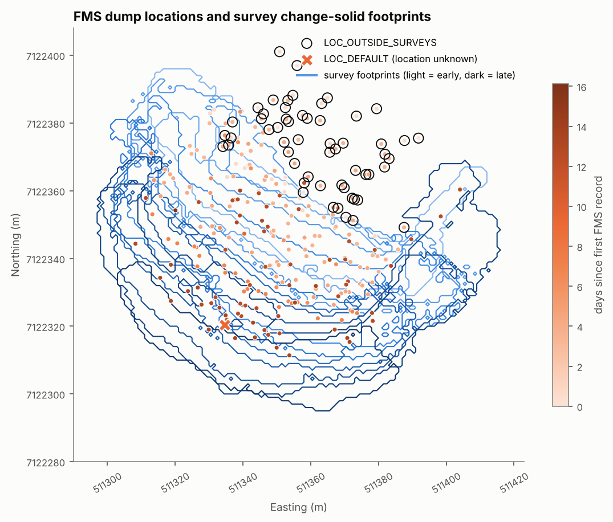

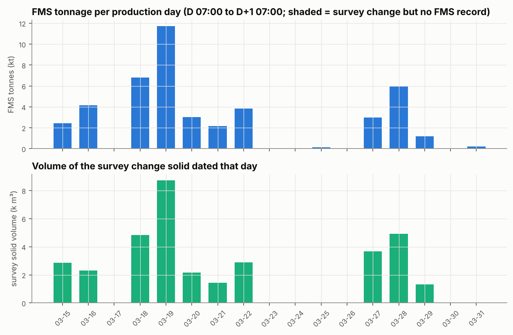

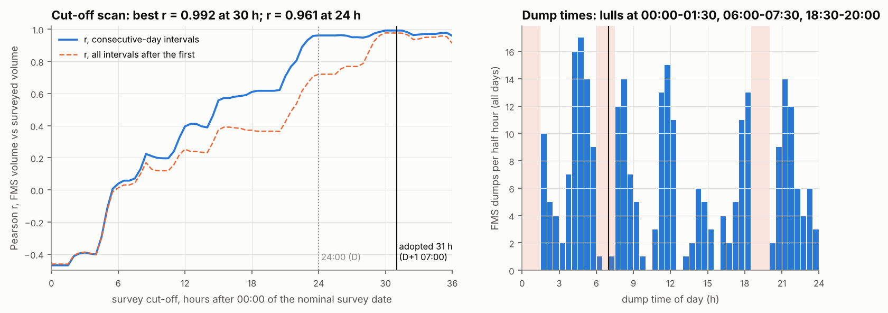

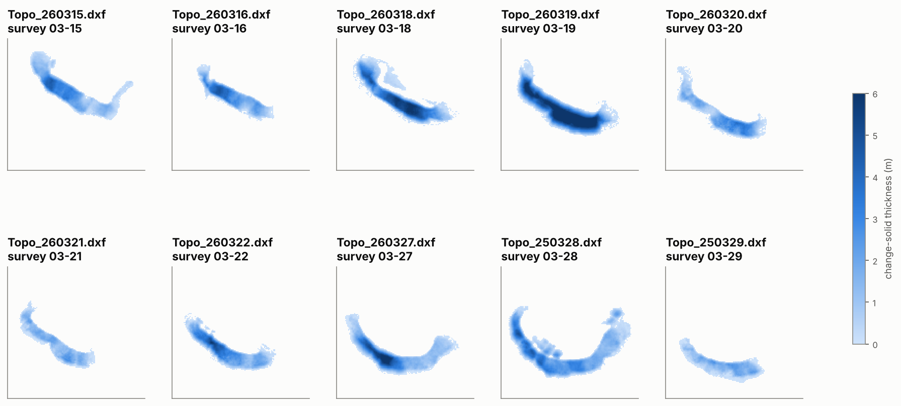

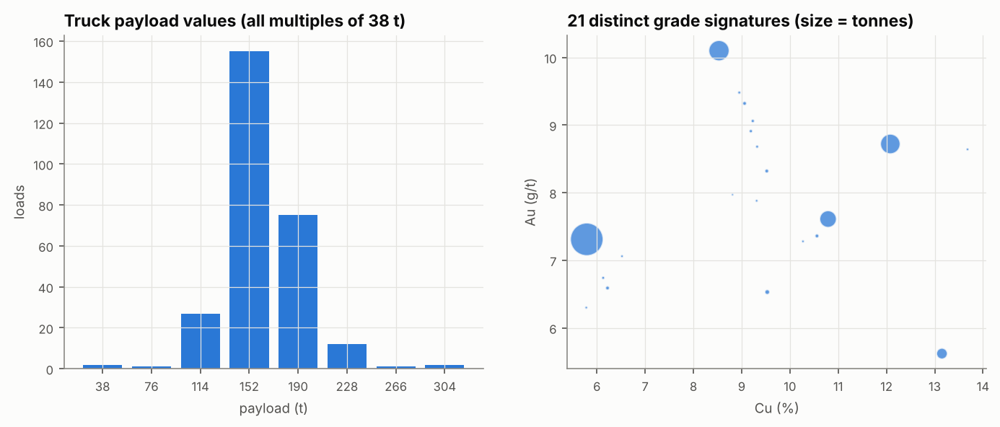

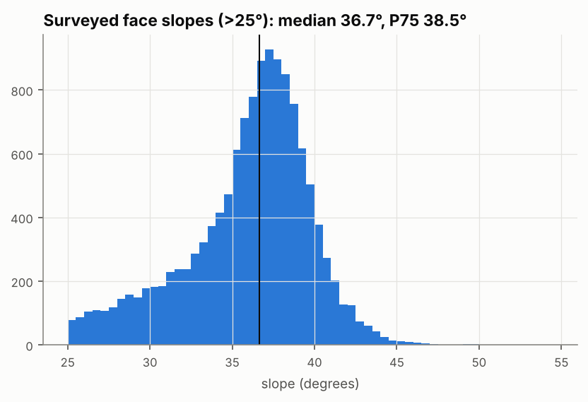

# Stockpile Growth Analysis

The stockpile grew by end-dumping on a platform at about 4,488-4,490 m. Dozers pushed material over a crescent-shaped crest, and the south face advanced about 30 m in two weeks (face-advance map below). The face stands at a median 36.7° (P75 38.5°). The floor is a near-horizontal plane at 4,475.1 m (dip 0.29°, residual SD 0.26 m).

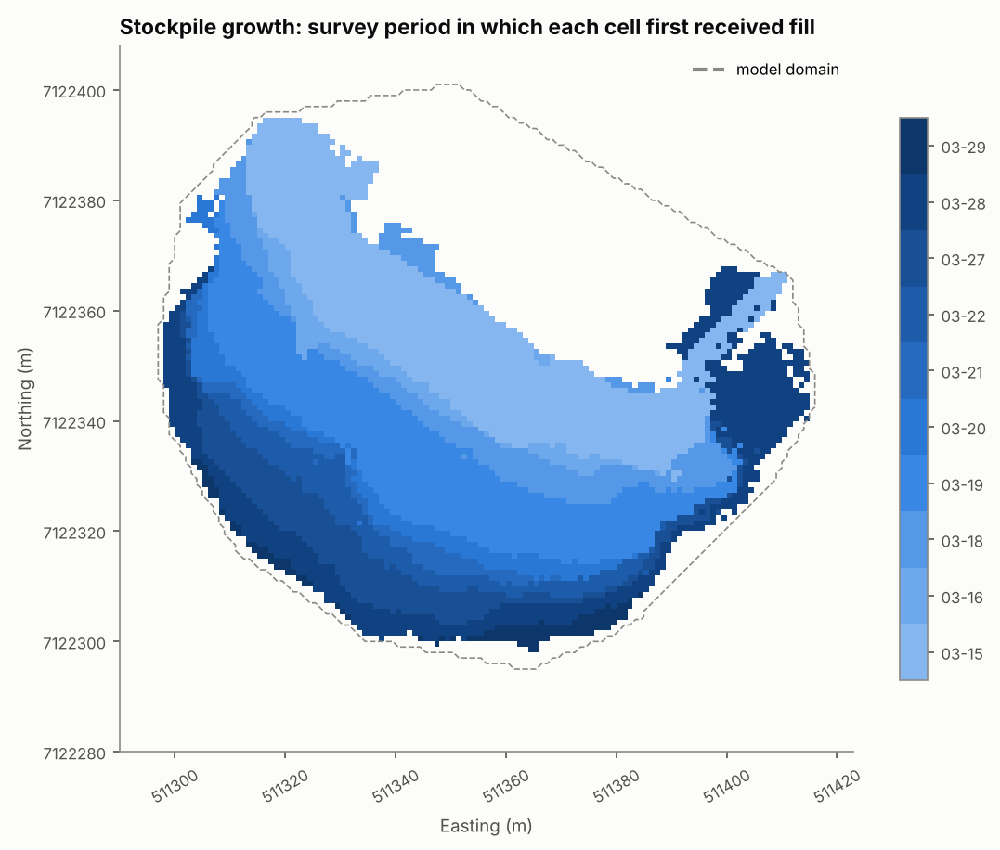

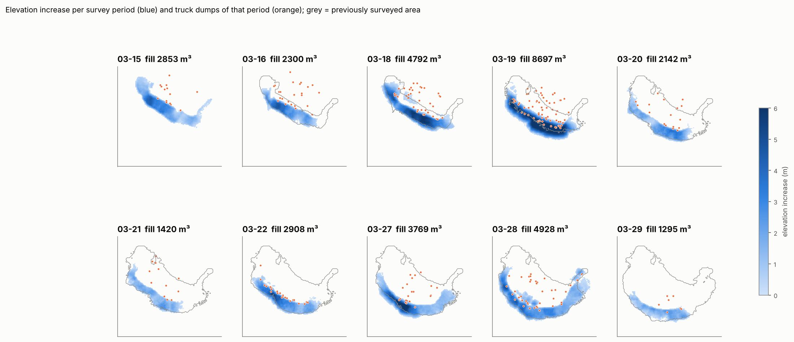

## When does a survey close its interval?

The surveys carry a date, not a time. The cut-off was scanned from 0 to 36 h after 00:00 of the nominal date (D2, Section 2.4):

*Survey cut-off scan (selected rows of outputs/growth/temporal_alignment.csv)*

| cut-off (h after 00:00 of D) | clock time | r (consecutive-day intervals) | robust CV of ratio | r (all intervals after the first) | loads after last survey |
|---|---|---|---|---|---|
| 0 | D+0 00:00 | -0.469 |  | -0.461 | 19 |
| 6 | D+0 06:00 | 0.039 | 0.73 | 0.013 | 8 |
| 12 | D+0 12:00 | 0.396 | 0.88 | 0.253 | 1 |
| 18 | D+0 18:00 | 0.610 | 0.42 | 0.372 | 1 |
| 21 | D+0 21:00 | 0.706 | 0.33 | 0.422 | 1 |
| 24 | D+1 00:00 | 0.961 | 0.23 | 0.720 | 1 |
| 27 | D+1 03:00 | 0.950 | 0.23 | 0.768 | 1 |
| 29 | D+1 05:00 | 0.974 | 0.23 | 0.927 | 1 |
| 30 | D+1 06:00 | 0.992 | 0.08 | 0.977 | 1 |
| 31 | D+1 07:00 | 0.992 | 0.08 | 0.976 | 1 |
| 31.5 | D+1 07:30 | 0.992 | 0.09 | 0.976 | 1 |
| 32 | D+1 08:00 | 0.981 | 0.10 | 0.965 | 1 |
| 34 | D+1 10:00 | 0.971 |  | 0.951 | 1 |
| 36 | D+1 12:00 | 0.959 |  | 0.912 | 1 |

Midnight is clearly not the cut-off. The correlation keeps rising after 24 h and plateaus between 30 and 31.5 h (D+1 06:00-07:30). The robust spread of the volume ratio falls by a factor of three (from 0.23 to 0.08). The FMS dump times show the reason. Dumping stops between 06:00 and 07:30 (2 dumps in two weeks), and again between 18:30 and 20:00. These are shift changes. A production day runs from one morning shift change to the next, and the survey labelled D was evidently taken at its end. We adopt **D+1 07:00** and sample 29-32 h in the Monte Carlo.

## FMS vs survey: the volume factor

The table below compares, per interval, the measured net fill (fill − revealed cuts) with the FMS volume at the recorded density, Σ T/Dens.

*Volume budget per survey interval (interval of survey D ends at D+1 07:00)*

| interval | survey (D) | fill m³ | cut m³ | net fill m³ | FMS t | Σ T/Dens m³ | longest FMS silence (h) | ratio | used for f_v | role in hold-out | hold-out error |
|---|---|---|---|---|---|---|---|---|---|---|---|
| 0 | 03-15 | 2,853 | 0 | 2,853 | 2,432 | 1,212 | 11 | 2.35 | no (FMS gap) | calibration |  |
| 1 | 03-16 | 2,300 | 0 | 2,300 | 4,142 | 1,931 | 19 | 1.19 | yes | calibration |  |
| 2 | 03-18 | 4,792 | 317 | 4,475 | 6,802 | 3,188 | 38 | 1.40 | yes | calibration |  |
| 3 | 03-19 | 8,699 | 0 | 8,699 | 11,704 | 5,495 | 6 | 1.58 | yes | calibration |  |
| 4 | 03-20 | 2,143 | 0 | 2,143 | 3,040 | 1,427 | 11 | 1.50 | yes | calibration |  |
| 5 | 03-21 | 1,420 | 4 | 1,416 | 2,166 | 1,019 | 13 | 1.39 | yes | held-out | -5.3% |
| 6 | 03-22 | 2,908 | 57 | 2,851 | 3,838 | 1,939 | 13 | 1.47 | yes | held-out | +0.5% |
| 7 | 03-27 | 3,770 | 13 | 3,757 | 3,116 | 1,617 | 64 | 2.32 | no (FMS gap) | held-out | +37.0% |
| 8 | 03-28 | 4,928 | 173 | 4,755 | 6,004 | 3,101 | 11 | 1.53 | yes | held-out | +4.6% |
| 9 | 03-29 | 1,295 | 0 | 1,295 | 1,178 | 596 | 23 | 2.17 | no (FMS gap) | held-out | +32.7% |

* **Complete intervals.** On the seven intervals whose FMS record is complete (blue in the figure), measured fill is a stable 1.19-1.58 times Σ T/Dens. The pooled value is **f_v = 1.472** (bootstrap P10-P90 1.40-1.52). The lowest ratio (03-16, 1.19) is dozer lag: 541 m³ of that day's FMS volume reaches the face on 03-18 and is carried forward explicitly.
* **FMS-gap intervals** (03-15, 03-27, 03-29) have ratios of 2.2-2.4. Their fill is only partly explained by FMS, and the rest becomes **unattributed** volume (2,869 m³ in total).
* **Prediction.** f_v calibrated on the first half of the record predicts the held-out complete intervals to 3.5%. A constant density gives 8.7%, and using Dens as the in-pile density (f_v = 1) gives 32%.

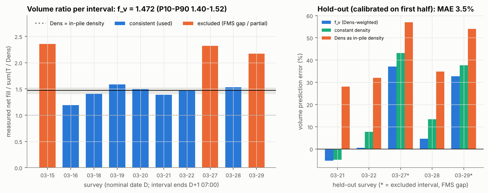

**What f_v means.** f_v fixes the in-pile **volume** of each load (T × f_v / Dens). How many **tonnes** that volume holds depends on why it is 47% larger than T/Dens, and the data cannot tell:

* **Bulking.** If the FMS density is a bank (in-situ) density, f_v = 1.47 is an ordinary swell factor for blasted rock. Recorded tonnes are then correct, and the in-pile density is 1.40 t/m³. This is our base case.
* **Under-recorded payloads.** Payload is passes × a nominal 38 t bucket. A larger real bucket factor would add tonnes. We allow up to 19% (f_pay = 1.19), at which the largest load (304 t) reaches 362 t, about the largest haul-truck rating. All of the excess (f_pay = 1.47) would need 448 t loads, which is excluded (X1).
* **Missing loads.** About 32% of the volume on otherwise complete days would have to come from trucks or loads absent from the FMS (X2). This cannot be excluded.

Version 1 of this report sampled the in-pile density only over κ = 0.80-1.05 times Dens. Its lowest value corresponds to f_v = 1.25, so the full bulking explanation (f_v ≈ 1.47, κ ≈ 0.68) was never tested, and most of the excess volume was booked as unattributed material. Section 10.2 reports all three interpretations.

**Other reconciliation features.**

* **Dozer lag (physical).** When an interval's FMS volume exceeds its fill, the surplus is retained on the platform and pushed in the next interval.
* **Cuts.** 565 m³ of dozer cuts were re-handled.

*Table 5.2 - Interval reconciliation in the base case (FMS m³ = in-pile volume T·f_v/Dens, including volume carried over from the previous interval)*

| survey (D) | gap | loads | FMS t | FMS m³ | solid m³ | fill m³ | cut m³ | unattributed m³ | retained m³ | FMS explains | FMS Cu % | FMS Au g/t |
|---|---|---|---|---|---|---|---|---|---|---|---|---|
| 03-15 |  | 14 | 2,432 | 1,784 | 2,867 | 2,853 | 0 | 1,069 | 0 | 63% | 8.08 | 9.47 |
| 03-16 |  | 25 | 4,142 | 2,842 | 2,306 | 2,300 | 0 | 0 | 541 | 100% | 10.52 | 7.50 |
| 03-18 | yes | 42 | 6,802 | 5,233 | 4,843 | 4,792 | 317 | 0 | 754 | 100% | 7.35 | 7.38 |
| 03-19 |  | 71 | 11,704 | 8,838 | 8,708 | 8,697 | 0 | 0 | 141 | 100% | 5.81 | 7.29 |
| 03-20 |  | 17 | 3,040 | 2,242 | 2,151 | 2,142 | 0 | 0 | 99 | 100% | 5.79 | 7.31 |
| 03-21 |  | 12 | 2,166 | 1,599 | 1,426 | 1,420 | 4 | 0 | 183 | 100% | 13.15 | 5.62 |
| 03-22 |  | 24 | 3,838 | 3,036 | 2,888 | 2,908 | 57 | 0 | 185 | 100% | 8.65 | 9.90 |
| 03-27 | yes | 21 | 3,116 | 2,565 | 3,679 | 3,769 | 13 | 1,191 | 0 | 68% | 11.85 | 8.60 |
| 03-28 |  | 41 | 6,004 | 4,564 | 4,919 | 4,928 | 173 | 191 | 0 | 96% | 11.05 | 9.09 |
| 03-29 |  | 7 | 1,178 | 877 | 1,310 | 1,295 | 0 | 418 | 0 | 68% | 8.73 | 9.80 |

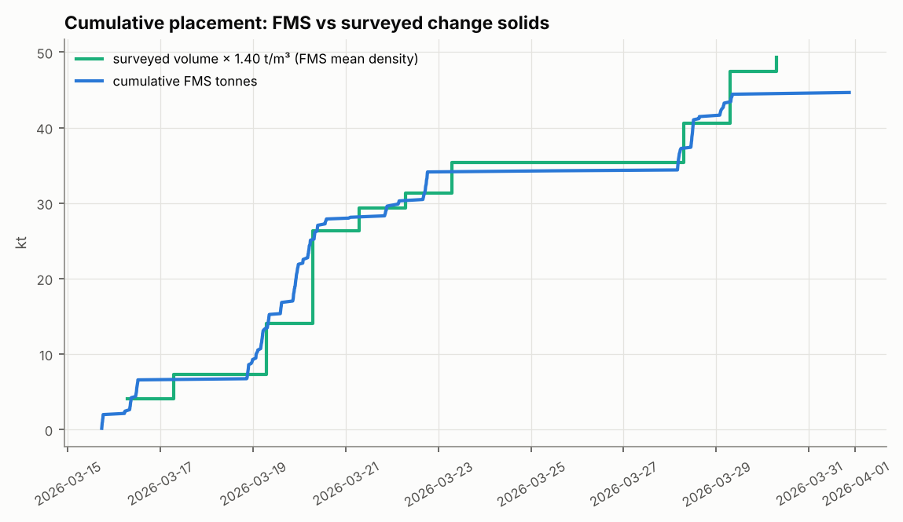

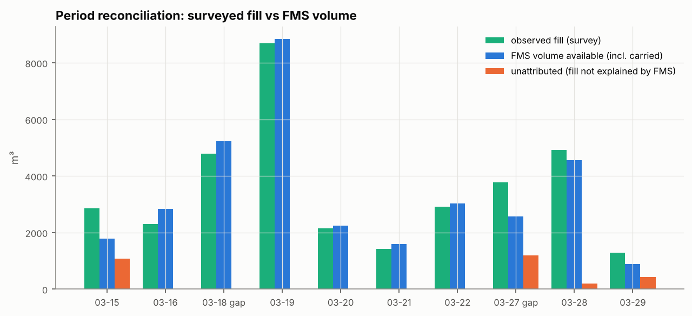

# Material-Movement Methodology

The full derivation, pseudocode and flowcharts are in D3. In summary, each interval's update answers the required questions:

| Question | CPST answer |
|---|---|
| A. Initial placement | Each load is a parcel of in-pile volume T·f_v/Dens at its reported X/Y (GPS error σ = 3 m in the Monte Carlo). Loads with a default FMS position have an unknown location (uniform cost) |
| B. Direction | Least-work route over the pre-interval terrain: geodesic distance with uphill penalty α = 4 m per m of lift. The survey decides which face sector received fill |
| C. Distance / stopping | Material stops where observed accommodation space exists (capacity constraint). Max push 90 m. Unplaceable volume is retained on the platform (dozer lag) |
| D. Downslope behaviour | The layer top is the surveyed surface, with faces at the measured repose angle. Forward model: avalanche CA at 37° |
| E. Mixing | Entropic OT with mixing length ε = 6 m. Grades composited from metal ÷ tonnes |
| F. Surface reconciliation | Column marginals = observed fill, so the model surface = survey (residual < 10⁻⁶) |
| G. Mass conservation | Row sums exact by construction; unattributed and pre-record volumes kept in separate classes |
| H. Metal conservation | All operations linear in metal; verified to 10⁻¹² relative |
| I. Sequential updating | Column stacks plus carried parcels form the initial state of the next interval. Cuts remove and re-handle the column top |
| J. Numerical stability | Log-domain Sinkhorn (tolerance 10⁻⁶); 1 m grid; robustness tested (Section 9.5) |

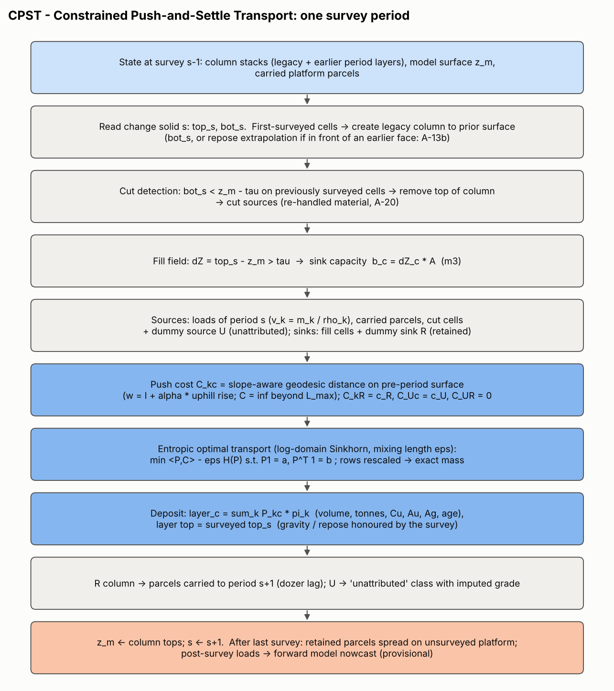

**Why optimal transport?** Moving cut volume to fill volume with minimum work is the original optimal-transport problem (Monge, 1781). The entropic form adds exactly one physically interpretable parameter, the mixing length. Sinkhorn iterations solve it robustly, and conservation is guaranteed. A rule that pushes each load to its nearest crest cell cannot honour the observed fill, and black-box regression has no training data. The forward-model test (Section 9.3) shows that physics alone predicts the fill location only moderately well, which confirms that the survey constraint is necessary.

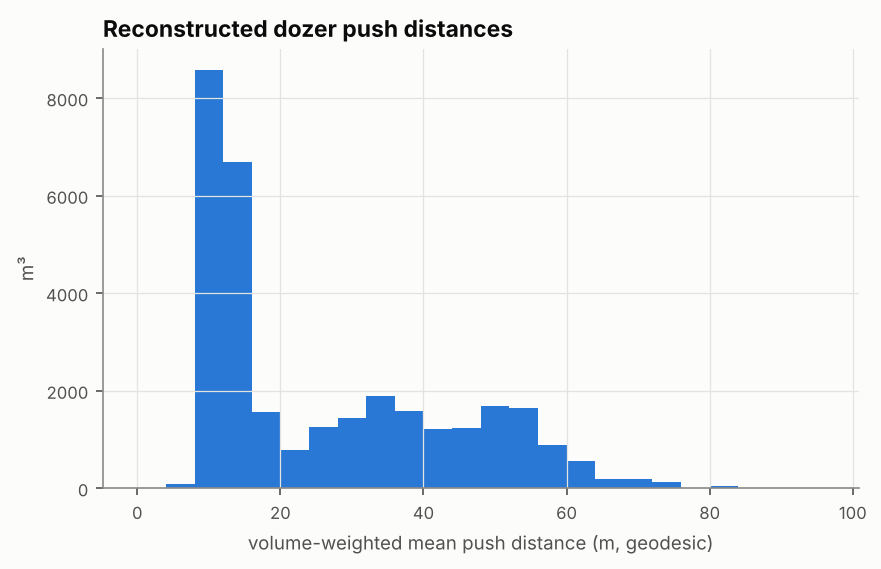

# Assumption Register

The complete register (32 assumptions with need, justification, consequence and treatment) is in D2 Section 4. The configuration file tags every parameter with its assumption ID. The assumptions with the greatest influence are:

| ID | Assumption | Effect if wrong | Treatment |
|---|---|---|---|
| A-06 | In-pile volume = T·f_v/Dens (f_v calibrated, 1.472); recorded tonnes correct (f_pay = 1) | Record-period tonnes +19% at f_pay = 1.19; +47% if the excess is missing loads | MC (f_v bootstrap, f_pay 1.00-1.19 triangular); tornado; scenarios X1 (excluded), X2 (not included) |
| A-22 | Pre-record core grade = FMS mean | Core metal could differ by any amount | Separate class; "Uninformed"; prior range; sampling (R-04) |
| A-13/A-14 | Geometry of never-surveyed parts | Core volume and extent | Full survey (R-03) |
| A-05 | Survey closes its interval at D+1 07:00 | Loads shift one interval | Cut-off scan; MC 29-32 h; tornado |
| A-18 | Mixing length 6 m | Block-scale grade smoothing | Twin experiments; MC; tornado |
| A-21 | Unattributed grade = neighbouring intervals | Grade of 2.8% of tonnes | Bootstrap in MC; separate class |
| A-32 | Default-position loads have unknown location | Allocation of 2.4 kt within their intervals | Uniform cost; tests |

# Block Model Construction

* **Block size 5 × 5 × 2 m** (27 × 26 × 10 grid; origin E 511,290 N 7,122,280 Z 4,474). Horizontal size is matched to the information resolution (GPS σ ≈ 3 m plus mixing length 6 m). Vertical size matches the daily layer thickness (median 0.9-3.0 m) and loader reclaim slices. Alternatives (2 × 2 × 1 m, 10 × 10 × 4 m) are tested in Section 10. Implementation B used 2 × 2 × 1 m blocks. We keep 5 × 5 × 2 m because the data cannot resolve grade below about 5 m, and smaller blocks would only add false precision.
* **Partial blocks** keep their exact material volume (fill fraction). There is no sub-blocking, because layers are integrated exactly.
* **Density** per material class: in-pile density Dens·f_pay/f_v for FMS loads; block density is derived as tonnes ÷ volume.
* **Compositing** is by metal ÷ tonnes. The within-block heterogeneity of mixed loads is reported.
* **Provenance**: each block lists its effective number of loads and its top three contributing cycle IDs, enabling reconciliation with plant data.
* **Uncertain or uninformed regions** are labelled by information class (FMS-reconciled, Unattributed-imputed, Legacy-assumed = pre-record core, Provisional) and by confidence class (High, Medium, Low, Uninformed).
* **Two class breakdowns exist, and both are correct.** The *exact* tonnage split (each block's tonnes divided among the classes) is `summary_by_material_source.csv` and `validation/inventory_by_class.csv`; it is the split quoted throughout this report. `summary_by_dominant_info_class.csv` instead assigns each *whole* block to its dominant class, for mapping and reclaim planning. Both sum to the same total.

*Table 8.1 - Inventory by confidence class*

| confidence | blocks | tonnes | cu_pct | au_gpt | cu_t | au_koz |
|---|---|---|---|---|---|---|
| High | 695 | 36,117 | 8.26 | 7.90 | 2,983 | 9.2 |
| Medium | 242 | 10,703 | 9.22 | 8.40 | 987 | 2.9 |
| Low | 122 | 6,574 | 8.97 | 8.30 | 590 | 1.8 |
| Uninformed | 1,640 | 84,951 | 8.43 | 8.01 | 7,161 | 21.9 |

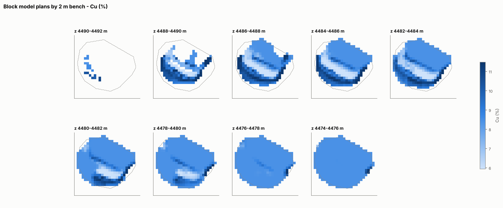

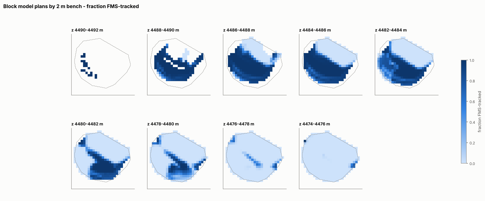

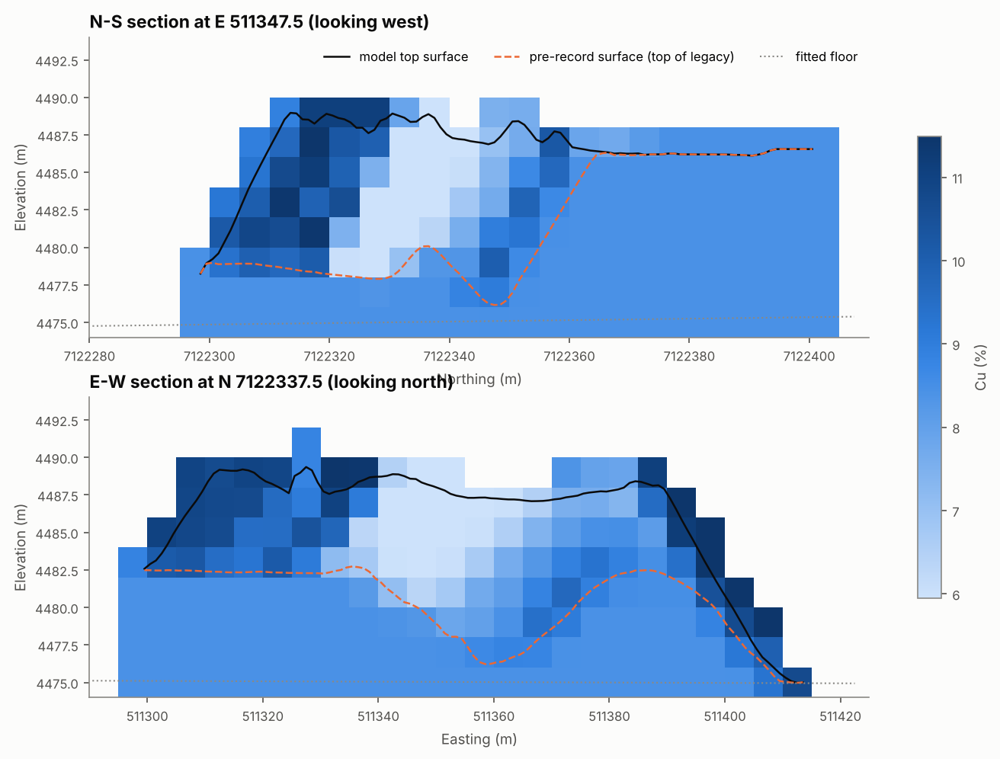

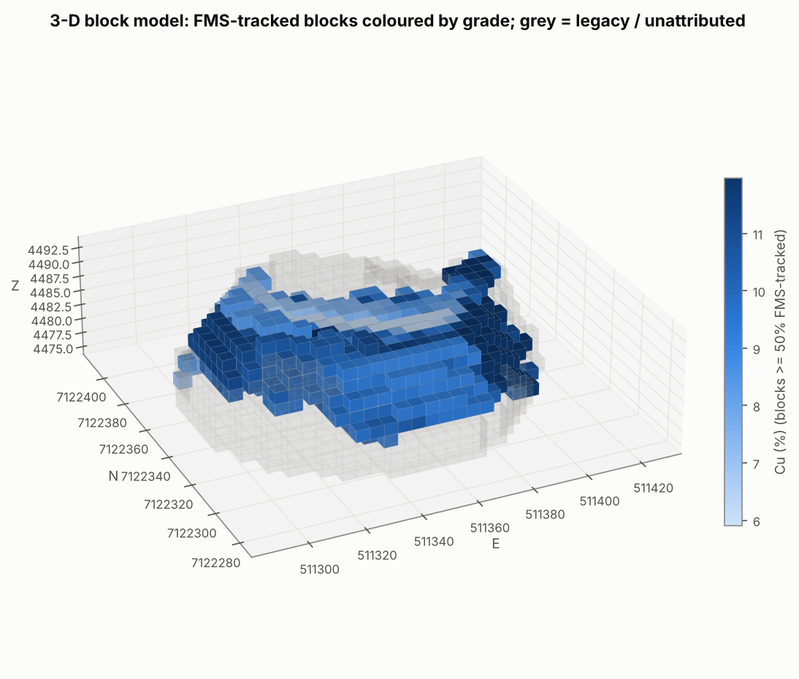

*Table 8.2 - Inventory by 4 m reclaim bench (all classes; see D4 for class split)*

| bench | blocks | tonnes | cu_pct | au_gpt | cu_t | au_koz |
|---|---|---|---|---|---|---|
| 4490-4494 | 18 | 50 | 8.72 | 9.96 | 4 | 0.0 |
| 4486-4490 | 460 | 14,305 | 8.75 | 8.15 | 1,251 | 3.7 |
| 4482-4486 | 671 | 40,591 | 8.45 | 8.02 | 3,429 | 10.5 |
| 4478-4482 | 757 | 46,928 | 8.43 | 8.00 | 3,957 | 12.1 |
| 4474-4478 | 793 | 36,472 | 8.44 | 8.00 | 3,080 | 9.4 |

# Validation and Reconciliation

## Mass and metal balance

*Table 9.1 - FMS mass and metal balance*

| quantity | unit | FMS input | block model | difference |
|---|---|---|---|---|
| FMS tonnes | t | 44,650.000 | 44,650.000 | 7.3e-12 |
| FMS Cu | t Cu | 3,760.423 | 3,760.423 | -8.2e-12 |
| FMS Au | kg Au | 357.124 | 357.124 | -8.5e-13 |
| FMS Ag | kg Ag | 8,824.138 | 8,824.138 | -1.8e-11 |

FMS tonnes, Cu, Au and Ag entering the stockpile equal the block model inventory to floating-point precision. Volume reconciliation for the whole record:

*Table 9.2 - Volume reconciliation over the record*

| item | value |
|---|---|
| survey change-solid volume (m3) | 35,095.6 |
| observed fill used by model (m3) | 35,104.8 |
|   of which unobserved fill on first-surveyed cells (m3) | 0 |
| cut / re-handled volume (m3) | 564.995 |
| sub-threshold change not modelled (m3) | 136.739 |
| FMS in-pile volume, T × f_v / Dens (m3) | 31,849.1 |
| volume placed into observed fill from loads, carried parcels and cuts (m3) | 32,241.3 |
| unattributed fill volume (m3) | 2,869.27 |
| FMS volume never reconciled (provisional) (m3) | 169.644 |
| max Sinkhorn column residual (relative) | 8.7611e-07 |

## Geometry

The survey-reconciled model surface differs from the latest surveyed surface by RMSE 0.03 m (bias -0.008 m). 100.0% of cells are within the 0.14 m detection limit. The residuals are sub-threshold changes that are intentionally not moved. Geometry is constrained by design, so this test verifies the numerics; the independent tests follow.

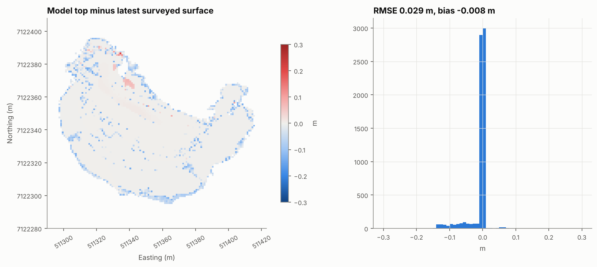

## Temporal behaviour (held-out intervals)

The forward physics model was calibrated on intervals 1-5: repose angle, deposit radius and release offset, 27 combinations. It was then tested on intervals 6-9, which it never saw. For each test interval it predicted the fill from the previous state and that interval's dumps only.

*Table 9.3 - Forward model: calibration and unseen test periods (means)*

| set | mode | W1 (m) | capture | centroid error (m) |
|---|---|---|---|---|
| calibration | no-push baseline | 19.0 | 0.32 | 17.6 |
| calibration | push (calibrated) | 16.4 | 0.36 | 15.3 |
| calibration | push (default) | 17.1 | 0.36 | 16.0 |
| calibration | uniform baseline | 23.2 | 0.17 | 12.7 |
| test (unseen) | no-push baseline | 14.3 | 0.46 | 11.2 |
| test (unseen) | push (calibrated) | 14.1 | 0.53 | 11.9 |
| test (unseen) | push (default) | 14.0 | 0.58 | 11.8 |
| test (unseen) | uniform baseline | 30.6 | 0.20 | 28.0 |

On the unseen intervals the dozer-push model (14.1 m) is far better than the no-information baseline (30.6 m, volume spread evenly over the pile). It is only marginally better than leaving material at the dump point (14.3 m), although it captures more of the observed fill. The absolute errors are large compared with the block size. **Physics alone cannot say where on a 100 m face a day's fill will land; the surveys must constrain it.** This justifies the survey-constrained design of CPST. The forward model is used only where no survey exists (nowcast of the 03-31 load).

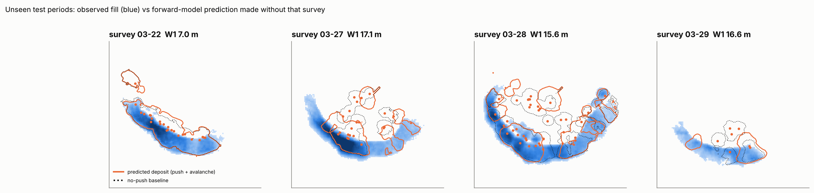

## Inversion skill: synthetic twin with known truth

A known-truth stockpile was generated from the real dump sequence with the forward model, with random dozer deviations of 6 m. It was then observed the way the real one is: change solids with survey noise, GPS error σ = 3 m, payload noise, and **15% of FMS records deleted**. Finally it was reconstructed blind.

*Table 9.4 - Synthetic twin: block-level accuracy vs known truth (blocks with > 25 t of true FMS material)*

| method | blocks | cu_rmse | cu_mae | cu_corr | au_rmse | au_corr | tonnes_corr |
|---|---|---|---|---|---|---|---|
| CPST eps=2 m | 684 | 0.81 | 0.54 | 0.90 | 0.31 | 0.95 | 1.00 |
| CPST eps=6 m (base) | 684 | 0.68 | 0.48 | 0.93 | 0.28 | 0.96 | 1.00 |
| CPST eps=15 m | 684 | 0.65 | 0.47 | 0.94 | 0.28 | 0.96 | 1.00 |
| CPST eps=6, no uphill penalty | 684 | 0.66 | 0.47 | 0.94 | 0.28 | 0.96 | 1.00 |
| Baseline: period-average (eps=1e4) | 684 | 1.19 | 0.91 | 0.82 | 0.66 | 0.82 | 0.99 |
| Reference: global mean grade | 684 | 1.87 | 1.58 |  |  |  |  |

CPST recovers block Cu grade with RMSE 0.68% Cu (r = 0.93). That is a 43% lower error than allocating each interval's loads uniformly over its fill, and far better than a single mean grade. In this twin a larger mixing length (ε = 15 m, 0.65%) does slightly better than the base 6 m, which suggests the base case may under-mix somewhat. ε is therefore sampled over 2-15 m in the Monte Carlo, and calibrating it with tracers is recommended (R-06).

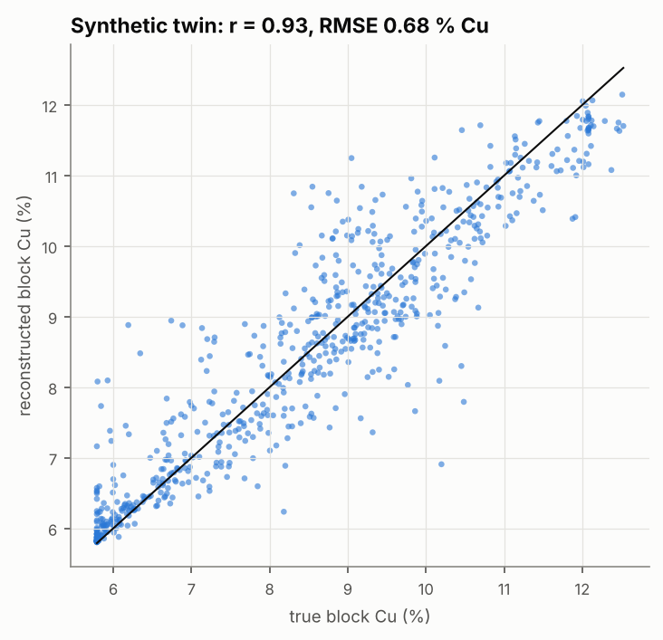

**Is the twin circular?** The main twin's truth comes from our own forward physics (push to the nearest crest, avalanche at 37°). CPST does not use the forward model, but its push cost encodes a similar idea: material goes to the nearby face. Two further twins therefore use truths generated by rules CPST does **not** assume:

* **Random crest.** Each load is pushed to a uniformly random point of the active crest, so the dump position carries no information about the destination.
* **Period-uniform mixing.** Each interval's fill is perfectly homogeneous.

*Table 9.5 - Twin stress tests: truth generated with placement rules CPST does not assume*

| truth | method | blocks | cu_rmse | cu_corr | au_rmse |
|---|---|---|---|---|---|
| physics (nearest crest + 6 m jitter) | CPST eps=6 m (base) | 684 | 0.68 | 0.93 | 0.28 |
| period-uniform mixing | CPST eps=6 m (base) | 684 | 0.51 | 0.96 | 0.21 |
| physics (nearest crest + 6 m jitter) | Baseline: period-average (eps=1e4) | 684 | 1.19 | 0.82 | 0.66 |
| period-uniform mixing | Baseline: period-average (eps=1e4) | 684 | 0.99 | 0.88 | 0.61 |
| physics (nearest crest + 6 m jitter) | Reference: global mean grade | 684 | 1.87 |  |  |
| period-uniform mixing | Reference: global mean grade | 684 | 1.77 |  |  |
| random-crest (dump position uninformative) | CPST eps=6 m (base) | 673 | 0.68 | 0.90 | 0.32 |
| random-crest (dump position uninformative) | Baseline: period-average (eps=1e4) | 673 | 1.06 | 0.82 | 0.55 |
| random-crest (dump position uninformative) | Reference: global mean grade | 673 | 1.59 |  |  |

When the dump position is uninformative, CPST's error is 0.68% Cu, practically the same as in the main twin (0.68%). It still beats the period-average model (1.06%) and the global mean (1.59%). Most of CPST's skill therefore comes from the survey constraint, which says which interval's material is where and in which layer. Under period-uniform mixing, CPST does not impose spurious structure (0.51% vs 0.99%).

## Robustness to numerical settings

*Table 9.6 - Robustness to numerical settings*

| variant | total_tonnes | fms_tonnes | unattributed_tonnes | legacy_tonnes | tracked_blocks_cu_pct | top_bench_cu_pct | mean_abs_block_cu_change |
|---|---|---|---|---|---|---|---|
| base (1 m cell, tol 1e-6) | 138,346 | 44,650 | 3,901 | 89,795 | 8.48 | 8.57 | 0.00 |
| cell 0.5 m | 137,394 | 44,650 | 3,926 | 88,818 | 8.48 | 8.57 | 0.08 |
| cell 2.5 m | 137,028 | 44,650 | 3,874 | 88,504 | 8.49 | 8.57 | 0.07 |
| Sinkhorn tol 1e-4 | 138,346 | 44,650 | 3,902 | 89,795 | 8.48 | 8.57 | 0.00 |
| Sinkhorn tol 1e-8 | 138,346 | 44,650 | 3,901 | 89,795 | 8.48 | 8.57 | 0.00 |
| LoD k=1 (tau 0.07 m) | 138,400 | 44,650 | 3,956 | 89,795 | 8.48 | 8.57 | 0.01 |
| LoD k=4 (tau 0.28 m) | 138,194 | 44,650 | 3,749 | 89,795 | 8.48 | 8.57 | 0.02 |

Class tonnages, tracked-block grade and top-bench grade are stable under changes of grid resolution, solver tolerance and detection limit. They are not artefacts of a single numerical setting.

## Volume conversion (hold-out)

See Section 5 and D2 Section 2.5. f_v is calibrated on the first half of the record and tested on the second. The mean absolute error on held-out complete intervals is 3.5%, against 8.7% for a constant density and 32% for f_v = 1. The leave-one-out error is 8.0%.

## Performance measures (summary)

| Measure | Value |
|---|---|
| FMS mass / metal balance error | < 10⁻⁹ relative |
| Geometry RMSE vs survey | 0.03 m |
| Sinkhorn max column residual | < 10⁻⁶ |
| Volume factor hold-out error | 3.5% (f_v = 1: 32%) |
| Forward model W1 (test intervals) | 14.1 m (no-push 14.3 m; uniform 30.6 m) |
| Twin block Cu RMSE / r | 0.68% / 0.93 |
| Automated tests | 66 (unit, real-data, platform) |

## Cross-implementation check

A second team (implementation B) built an independent platform from the same brief and data. Its methods differ from ours in three ways:

* a FIFO pad-buffer stock-flow decides how much of each load enters each interval's fill, before a Sinkhorn allocation with ε = 3 m and sparsification (CPST does both in one transport problem, with dummy nodes);
* 2 × 2 × 1 m blocks;
* its own rasteriser and QA code.

Where the two answer the same question, they agree:

*Table 9.7 - Cross-implementation comparison (B's values from its own report)*

| quantity | A (this platform, v2.0) | B (independent implementation) |
|---|---|---|
| Survey cut-off | D+1 07:00 (scan plateau 30-31.5 h) | D+1 07:00 (scan peak about 30 h) |
| Fill / revealed cut / net fill (m³) | 35,108 / 565 / 34,543 | 35,107 / 583 / 34,627 |
| Volume factor f_v | 1.472 | 1.476 |
| Intervals used for f_v | 1 2 3 4 5 6 8 | 1 2 3 4 5 6 8 |
| Hold-out error (first half predicts second) | 3.5% | 3.2% |
| Unattributed volume (m³) and intervals | 2,869 (0, 7, 8, 9) | 2,431 (0, 7, 8, 9) |
| Record-period tonnes, base case | 48,551 | 47,600 |
| Record-period contained Cu (t), base case | 4,159 | 4,062 |
| FMS material if Dens is the in-pile density (t) | 65,713 (X1) | 65,600 (reported outside its ranges) |
| LOC_DEFAULT records / t | 14 / 2,356 | 14 / 2,356 |
| LOC_OUTSIDE_SURVEYS records / t | 56 / 9,120 | 58 / 9,462 |
| LOC_Z_INCONSISTENT / TIME_AFTER_LAST_SURVEY | 2 / 1 | 2 / 1 |
| PAYLOAD_PARTIAL / PAYLOAD_HIGH | 3 / 3 | 3 / 3 |
| DXF header units | $INSUNITS = 1 (inches) in all files; ignored | $INSUNITS = 1 in all files; ignored |
| Forward model, held-out earth-mover distance: push / no push / uniform (m) | 14.1 / 14.3 / 30.6 | 12.2 / 14.5 / 27.9 |
| Block size | 5 × 5 × 2 m | 2 × 2 × 1 m |
| Automated tests | 66 | 65 |

The agreement on f_v and on the consistent intervals matters most. Two different codes, with different rasterisation and cut detection, measure the same physical ratio from the same data. Both find the unattributed volume in the same four intervals (0, 7, 8, 9). The record-period inventories differ by about 2%, mainly because the unattributed volumes differ: B books fill within a survey tolerance band to its pad buffer. B's numbers are quoted from B's report and were not re-run.

# Uncertainty and Sensitivity Analysis

## Monte Carlo and tornado

Sixty Monte Carlo realisations jointly sampled the following (D3, Section 7):

* truck GPS error (σ 3 m);
* per-load tonnage error (8%) and the systematic payload factor (f_pay 1.00-1.19, triangular with mode 1.00);
* the volume factor (bootstrap of its calibration at the sampled cut-off);
* assay error (10% per grade signature);
* survey bias (5 cm);
* survey cut-off (29-32 h);
* mixing length (2-15 m), uphill penalty (1-10) and maximum push (50-130 m);
* the unattributed grade (bootstrap).

*Table 10.1 - Monte Carlo summary (60 realisations): record-period rows first; class_t_l = pre-record core*

| quantity | P10 | P50 | P90 | cv |
|---|---|---|---|---|
| record_period_tonnes | 48,083.63 | 52,496.89 | 56,006.40 | 0.062 |
| record_period_cu_t | 4,084.61 | 4,427.36 | 4,951.81 | 0.076 |
| record_period_au_kg | 381.19 | 416.75 | 464.04 | 0.077 |
| fms_tonnes | 45,203.10 | 47,124.91 | 49,666.79 | 0.040 |
| class_t_u | 1,660.51 | 4,660.75 | 8,890.87 | 0.533 |
| class_fms_cu_pct | 7.98 | 8.50 | 8.79 | 0.040 |
| class_fms_au_gpt | 7.51 | 8.00 | 8.51 | 0.050 |
| class_t_l | 86,603.64 | 94,912.28 | 103,077.82 | 0.072 |
| total_tonnes | 134,036.38 | 147,624.14 | 158,568.00 | 0.067 |
| cu_t | 11,284.21 | 12,413.00 | 13,790.62 | 0.080 |
| au_kg | 1,076.56 | 1,175.82 | 1,308.66 | 0.082 |
| cu_pct | 8.00 | 8.54 | 8.83 | 0.040 |
| au_gpt | 7.54 | 8.03 | 8.53 | 0.049 |

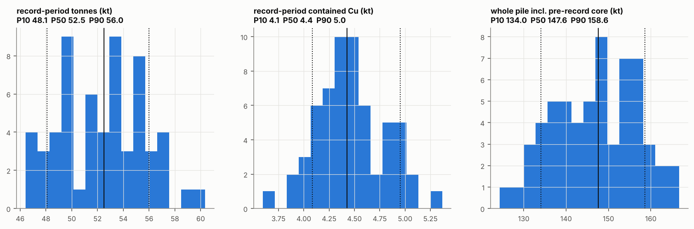

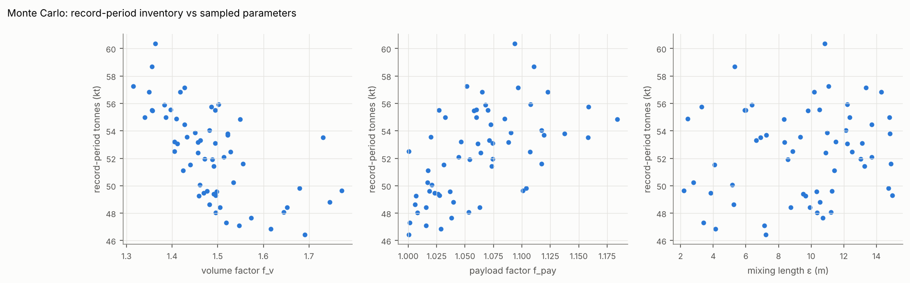

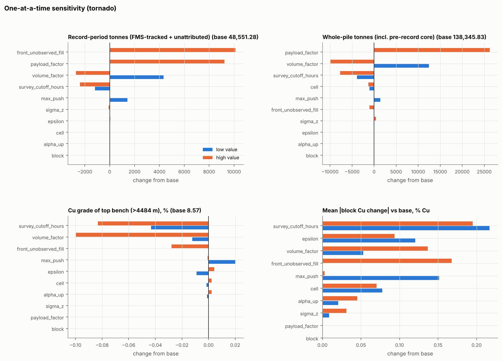

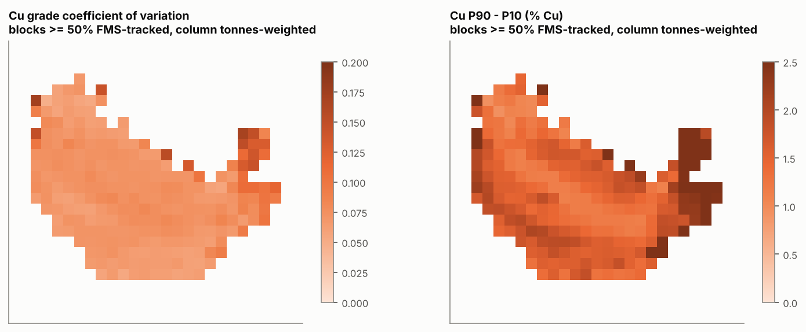

**Interpretation.**

* **Record-period tonnage** is driven by the payload factor, the volume factor (scatter plot above) and the A-13b switch. Moving the survey cut-off to 29 or 32 h changes record-period tonnes by 2%-5%, mostly through the recalibrated f_v. It still moves block grades by up to 0.22% Cu on average, because loads dumped within an hour or two of the cut-off change interval.
* **Whole-pile tonnage** is driven by the payload and volume factors, because they set the in-pile density that converts the pre-record core's volume into tonnes. The A-13b switch moves about 10 kt from the core to the unattributed class.
* **Spatial grade field.** The survey cut-off, the movement parameters, the grid and the A-13b switch drive the grade field of the FMS-tracked material (mean absolute block Cu change in the tornado). The Monte Carlo block Cu CV for FMS-tracked blocks has a median of 7% (P90 9%).
* **What the Monte Carlo cannot quantify.** The pre-record core grade is an assumption, not a measurement. For blocks with less than 50% FMS-tracked material we therefore report a *prior* range: the load-scale P10-P90 of all FMS loads, 5.8-12.1 % Cu. We do not report Monte Carlo precision for these blocks, because it would be false.

## Interpretations of the volume gap (scenarios)

The calibrated f_v fixes the in-pile volume of the FMS material. The scenarios below differ only in how many tonnes the **same surveyed volume** holds.

*Table 10.2 - Interpretations of the volume gap: what each scenario assumes*

| scenario | status | description |
|---|---|---|
| S0 | base case | Recorded tonnes correct; the volume excess is bulking (Dens read as bank density, f_v as swell). |
| S1 | inside the Monte Carlo range (upper end) | Payloads under-recorded by 19% (largest load 304 t -> 362 t, the rated payload of the largest haul trucks); rest is bulking. |
| S2 | sensitivity (not in Monte Carlo) | A-13b on: fill inferred in front of earlier faces is counted as unrecorded material. |
| X1 | EXCLUDED | All of the excess is payload under-recording (f_pay = f_v = 1.47): largest load would be 447 t, above any haul-truck rating. |
| X2 | NOT INCLUDED in the ranges (cannot be excluded) | Dens is the in-pile density and the excess volume is loads missing from the FMS: about 32% of the volume on days with otherwise complete records. |

*Table 10.3 - Tonnes under each interpretation (outputs/uncertainty/scenarios.csv)*

| scenario | f_v | f_pay | in-pile t/m³ | largest load t | FMS t | unattributed t | record-period t | record-period Cu t | pre-record core t | whole pile t |
|---|---|---|---|---|---|---|---|---|---|---|
| S0 | 1.472 | 1.00 | 1.40 | 304 | 44,650 | 3,901 | 48,551 | 4,159 | 89,795 | 138,346 |
| S1 | 1.472 | 1.19 | 1.67 | 362 | 53,134 | 4,643 | 57,776 | 4,949 | 106,856 | 164,632 |
| S2 | 1.472 | 1.00 | 1.40 | 304 | 44,650 | 14,032 | 58,682 | 4,977 | 78,614 | 137,295 |
| X1 | 1.472 | 1.47 | 2.07 | 447 | 65,713 | 5,742 | 71,455 | 6,121 | 132,154 | 203,609 |
| X2 | 1.000 | 1.00 | 2.07 | 304 | 44,650 | 26,688 | 71,338 | 6,091 | 132,154 | 203,492 |

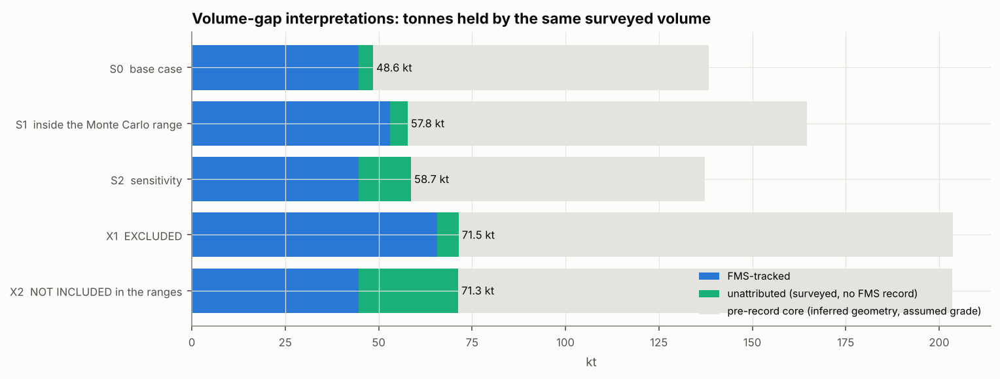

* **S0 and S1** bound the Monte Carlo range.
* **S2** (A-13b on) changes the class split rather than the total.
* **X1** is excluded on physical grounds.
* **X2 is not included in the reported ranges** because the evidence weighs against it, not because it is impossible. If the FMS density is a loose (truck-box) density, X2 or payload under-recording becomes the likelier explanation, and record-period tonnes rise to about 71,338 t. The basis of the FMS density must be confirmed (R-02).

Information types in the results: measured (survey solids, FMS inputs), inferred (survey cut-off, f_v, floor, pre-record surface), assumed (pre-record grade, f_pay split, unattributed grade) and model-generated (load destinations, block grades, ranges). The block model distinguishes them field by field (D4, Section 1.1).

# Automated Platform

The platform (`spbm`, D5) performs the eleven required steps with one command:

* **Import** of new FMS and survey files into a managed raw store. Files are named by SHA-256 and logged in `ingest_log.csv`. A changed file with an existing name is refused unless a `supersede` intervention authorises it.
* **QA/QC** with a 40-rule catalogue, the survey cut-off scan, and the volume-factor calibration with hold-out.
* **CPST.**
* **Block model and inventories**, including record-period vs pre-record classes.
* **Uncertainty**: Monte Carlo, tornado and volume-gap scenarios.
* **Exports**: CSV, VTK, ESRI grids, figures.
* **Audit trail**:
  * run manifest with the code commit (or, without Git, the packaged commit from `BUILD_INFO.json`);
  * SHA-256 of the platform source;
  * library versions, configuration hash and input hashes;
  * the applied manual interventions, each with reason, author and date;
  * model history, and an automatic change report between versions.

Manual corrections are possible only through `config/manual_interventions.csv`. A row without a reason, author or date stops the run. Sixty-six automated tests guard every change. They cover synthetic unit cases, real-data facts (for example the calibrated f_v, the cut-off optimum and the rule counts) and the platform end to end. The update workflow is demonstrated in `examples/demo_update.sh`: a model built to the 03-22 survey, then updated with the later data.

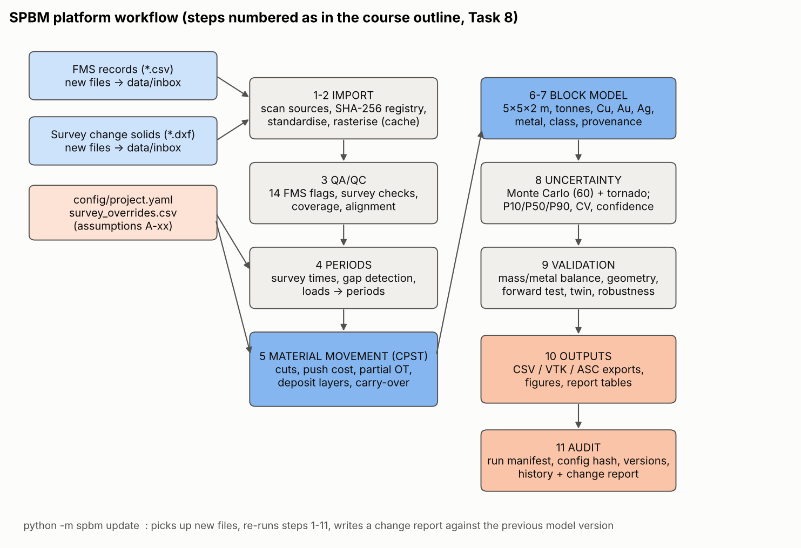

# Results and Discussion

1. **Where the dumped material is.** FMS-tracked material forms a skin on the south and west faces and the upper benches, laid in daily layers that dip with the face (see the block model sections). The median reconstructed push is about 17 m per load (P90 about 51 m). A typical load is spread over a patch of face about 23 m across, reflecting dozer spreading and rolling on the face.
2. **Grade pattern.** Grade varies strongly between production days, from 5.8% Cu (03-19, 03-20) to 13.2% (03-21) and 12.2% (03-27). The tracked material is therefore banded parallel to the face. A reclaim cut advancing from the south face would see the feed grade change by more than a factor of two over about 20 m, so it must be blended.
3. **The record-period inventory is now consistent between the surveys and the FMS.** Once the cut-off and the volume factor are calibrated, recorded loads explain the measured fill of every complete day. Only 2,869 m³ of surveyed fill (about 8% of the fill) has no FMS source. Nearly all of it falls in the three FMS-gap intervals; only 191 m³ falls on complete days, within their day-to-day scatter. Version 1 booked roughly ten times as much unattributed material, because it did not calibrate the volume conversion.
4. **The pre-record core dominates the whole-pile tonnage** but carries no grade information in the supplied data. Its geometry (floor plane plus inferred platform) is also the least certain part of the model.
5. **The volume excess is the open question.** Bulking (our base case) and missing tonnes are indistinguishable from volumes alone. The answer moves the record-period tonnes by up to 47%.

# Professional Accountability, Ethics and Equity

**Scenario.** Management requests a definitive Cu-Au inventory and reclaim sequence. Some regions are highly uncertain, and data completeness is uneven across periods (and, at an operating mine, possibly across crews, contractors or systems).

**Our position.**

* *We will provide an inventory, but not a single "definitive" number.* We lead with the record-period inventory, which is tied to surveyed fill and measured grades, with its P10/P50/P90. We state what the ranges do *not* include (missing loads, X2). The pre-record core is reported separately, and a target that relies on it is labelled "unsupported by data until sampled".
* *Limitations that must not be hidden:*
  * 64.9% of the whole-pile tonnes have an assumed grade;
  * the volume excess has two unresolved explanations;
  * the grade units are unconfirmed;
  * the mixing parameters are not calibrated in the field.
* *Correcting our own work.* Version 1 of this analysis had a timing artefact and an untested density hypothesis. Both were found by comparing it with an independent implementation. The corrections, and their effect on the numbers, are documented (D1 decision log, Appendix A). The superseded headline (202 kt) must not be reused.
* *When to qualify or decline.* We decline to certify a whole-pile metal inventory, or a 12-month reclaim schedule that depends on the pre-record core. We qualify the near-term schedule on FMS-tracked benches with ranges.
* *Responsibility and evidence.* The model should be independently reviewed by a second engineer and by geology/survey before operational use. It should then be validated against reclaim reconciliation (mill or stacker grades vs block predictions) for at least the first months.
* *Documentation.* Every assumption, correction and manual intervention is in the register and the run manifests. The model history keeps prior versions.
* *AI and external code.* AI assistance was substantial and is disclosed in Appendix A, together with how it was verified. Code is protected by automated tests. Engineering decisions remain the team's.

**Equity and inclusive decision-making.**

* *Systematic bias from unequal data.* Average-grade imputation for gap intervals and pre-record material can systematically mis-state the least-documented regions. These blocks are flagged, never blended silently into "measured" totals.
* *Attribution risk.* The supplied data contain no crew or contractor identifiers. The observed gaps line up with *periods and systems*: FMS outages, missing or clipped surveys, template DXF headers. The volume excess could be read as "someone is not recording loads", but it is equally consistent with ordinary swell. Discrepancies must not be attributed to people without evidence. Any operational investigation should start from system logs and involve the crews concerned.
* *Explainability.* Maps, classes and block provenance (which loads are in a block) let planners, operators and plant staff question the model. Plain-language summaries accompany every release.
* *Inclusion of perspectives.* Geology (grade units, pre-record history), survey (timing, clipping, units), operations (dozer practice, bucket calibration), processing (blend limits) and finance (risk ranges) should review each release.
* *Usability.* One-command operation, readable configuration with assumption IDs, and CSV outputs let engineers without programming expertise run and audit the platform.
* *Controls:*
  * a stage-gate sign-off;
  * mandatory display of confidence classes;
  * a "no single number" rule;
  * change reports between versions;
  * interventions that need a reason, author and date;
  * independent verification of code changes.

# Limitations

1. No full-pile or pre-stockpile ground survey. The geometry of the unsurveyed platform and the back of the pile is inferred (A-13, A-14), and the floor is a fitted plane.
2. Two weeks of FMS against a pile built over the life of Pit I. The pre-record core grade is assumed.
3. The split of the volume excess between bulking and unrecorded tonnes is not identifiable (A-06). The base case assumes bulking.
4. Grades are source-block values (no within-load variability); payloads are pass-count estimates; moisture basis unknown.
5. Missing surveys and toe-clipped solids. The survey cut-off is inferred, not recorded.
6. Within-interval vertical homogeneity (A-19); no particle-size segregation (A-27); no settlement (A-28).
7. Mixing length and push parameters are supported by the synthetic twins but not calibrated with field tracers.
8. Confidence classes are internal planning classes, not JORC/NI 43-101 categories.

# Recommendations for Mine Implementation

| # | Recommendation | Purpose | Priority |
|---|---|---|---|
| R-01 | FMS completeness audit for 03-23 to 03-27 and after 03-29 08:17; fix outage alarms | Convert unattributed to tracked | High |
| R-02 | Confirm whether the FMS `Dens` is a bank or loose density; bulk-density test on the pile (e.g. weighed reclaim against surveyed volume); calibrate loader bucket factors | Resolve the volume excess (A-06): bulking vs missing tonnes | High |
| R-03 | Full-pile drone/LiDAR survey now; locate any pre-stockpile ground survey | Remove A-13/A-14; pre-record core volume | High |
| R-04 | Sampling programme (trenching or sonic drilling) of the pre-record core: grade, density, moisture | Replace assumed grades; confirm units (QA-F04) | High |
| R-05 | Survey protocol: record the acquisition time; export full-pile surfaces daily; do not clip change solids at the toe; fix the DXF unit header | Remove A-05; units | Medium |
| R-06 | Reclaim reconciliation: compare stacker/mill grades with block `top_loads` predictions; RFID tracer trial | Calibrate ε and the push model | Medium |
| R-07 | Record truck ID and source bench in FMS dump events; per-load grade where available | Within-load variability; traceability | Medium |
| R-08 | Adopt SPBM with governance: owner, reviewer, stage-gate sign-off, monthly re-run, version log | Accountability | High |

# Conclusions

The supplied data support a defensible reconstruction of the material dumped during 15-31 March 2026. The change-solid surveys serve as measured fill. A survey cut-off and a volume factor are calibrated from the data and verified on held-out intervals. A conservative, survey-constrained optimal-transport allocation then places every FMS tonne and every unit of metal in a 3-D block model, with exact balances, quantified uncertainty and full provenance.

The record-period inventory is 48,551 t (P10-P90 48.1-56.0 kt), with one explicitly stated exclusion: tonnes missing from the FMS. It agrees with an independent implementation to about 2%. Independent tests show that the method recovers block grades far better than simpler alternatives. Most of the whole pile pre-dates the record and has no grade information in the supplied data. The responsible deliverable is therefore:

* an inventory with ranges and explicit information classes;
* a near-term reclaim plan on the well-informed outer benches;
* a targeted data-collection programme for the rest, starting with the density basis.

The platform makes the analysis repeatable and auditable as new surveys and FMS records arrive.

# References

* Bak, P., Tang, C. and Wiesenfeld, K. (1987). Self-organized criticality: an explanation of 1/f noise. *Physical Review Letters* 59, 381-384.
* Caterpillar Inc. *Caterpillar Performance Handbook* (current edition).
* Chizat, L., Peyré, G., Schmitzer, B. and Vialard, F.-X. (2018). Scaling algorithms for unbalanced optimal transport problems. *Mathematics of Computation* 87, 2563-2609.
* Cuturi, M. (2013). Sinkhorn distances: lightspeed computation of optimal transport. *NeurIPS* 26.
* Dijkstra, E.W. (1959). A note on two problems in connexion with graphs. *Numerische Mathematik* 1, 269-271.
* Engineers Canada (2016, updated). *Code of Ethics* and *Public Guideline on the Code of Ethics*.
* Monge, G. (1781). *Mémoire sur la théorie des déblais et des remblais.*
* Peyré, G. and Cuturi, M. (2019). Computational optimal transport. *Foundations and Trends in Machine Learning* 11, 355-607.
* Wheaton, J.M. et al. (2010). Accounting for uncertainty in DEMs from repeat topographic surveys. *Earth Surface Processes and Landforms* 35, 136-156.

# Appendices

* **Appendix A** - Use of software, code and AI, including the A + B integration (`docs/Appendix_A_AI_and_Software_Disclosure.md`).
* **Appendix B** - Data and Assumption Register (D2).
* **Appendix C** - Technical methodology, equations and pseudocode (D3).
* **Appendix D** - Block model file description (D4).
* **Appendix E** - Platform user and audit guide (D5).
* **Appendix F** - Key result tables generated by the run (`outputs/report_tables.md`) and run manifest (`outputs/audit/run_manifest.json`).
